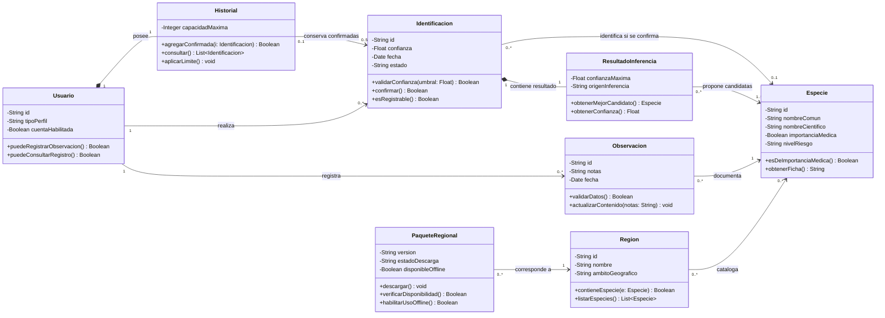
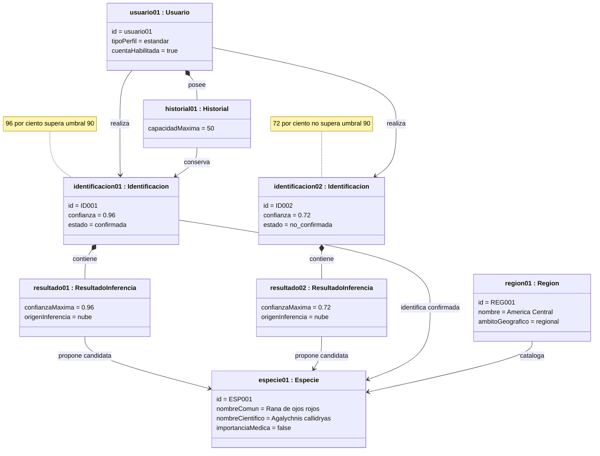

# De los requisitos a las clases

**Asignatura:** Ingeniería de Software I · SIS3407  
**Sistema:** BIOMA — Sistema de detección de flora y fauna local para senderistas  
**Autor:** Santiago Pacheco Carrillo  
**Documento:** DOO_S12S13  
**Especificación de referencia:** BIOMA_especificacion_requisitos_v1.2.md (04/11/2026)

> **Criterio de trabajo:** Se aplica la técnica de sustantivos presentada en clase. El punto 1 reproduce las secciones 1 a 6 de la especificación original, sin modificar sus requisitos, y marca sustantivos con `<ins>subrayado</ins>`. Los puntos 2 a 4 son decisiones de análisis y diseño propuestas, no clases ya implementadas.

---

## 1. Especificación de requisitos con sustantivos subrayados

Se conserva el texto de propósito, usuarios, requisitos funcionales, requisitos no funcionales, casos de uso y trazabilidad. El subrayado es deliberadamente amplio: todavía **no se descartan** sustantivos.

### 1. <ins>Propósito</ins> y <ins>alcance</ins>

**<ins>Propósito</ins> del <ins>documento</ins>:**

El <ins>propósito</ins> de este <ins>documento</ins> es especificar los <ins>requisitos</ins> del <ins>sistema</ins>
BIOMA, estableciendo de manera clara y verificable las <ins>funcionalidades</ins>,
<ins>restricciones</ins> y <ins>atributos</ins> de <ins>calidad</ins> que deberá cumplir el <ins>sistema</ins>
durante su <ins>desarrollo</ins>.

El <ins>documento</ins> está dirigido al <ins>equipo</ins> de <ins>desarrollo</ins> y a las <ins>personas</ins>
involucradas en la <ins>definición</ins>, <ins>revisión</ins> y <ins>validación</ins> del <ins>sistema</ins>.
Servirá como referencia para el <ins>diseño</ins>, <ins>implementación</ins>, <ins>pruebas</ins> y
posterior análisis de <ins>cambios</ins> de los <ins>requisitos</ins> del <ins>producto</ins>.

**<ins>Alcance</ins> del <ins>sistema</ins>:**

BIOMA es un <ins>sistema</ins> para la <ins>identificación</ins> de <ins>especies</ins> de <ins>flora</ins> y <ins>fauna</ins>
local mediante la <ins>cámara</ins> de un <ins>teléfono inteligente</ins>. El <ins>sistema</ins> analiza
las <ins>imágenes</ins> proporcionadas mediante <ins>modelos de identificación</ins> entrenados
con <ins>datos regionales</ins> y presenta al <ins>usuario</ins> <ins>información</ins> relacionada con
la <ins>especie</ins> identificada.

Para las <ins>especies</ins> generales incluidas en el <ins>modelo</ins>, BIOMA establece una
<ins>precisión</ins> mínima del <ins>modelo</ins> del 90 %. Una <ins>identificación</ins> individual
requiere un <ins>nivel de confianza</ins> mínimo del 90 % para presentarse como
<ins>identificación confirmada</ins>.

Para <ins>especies</ins> clasificadas como de <ins>importancia médica</ins>, BIOMA establece
una <ins>precisión</ins> mínima del <ins>modelo</ins> del 99 %. Una <ins>identificación</ins> individual
de una <ins>especie</ins> de <ins>importancia médica</ins> requiere un <ins>nivel de confianza</ins>
mínimo del 99 % para presentarse como <ins>identificación confirmada</ins>.

Cuando una <ins>identificación</ins> no <ins>alcance</ins> el <ins>nivel de confianza</ins> requerido,
el <ins>sistema</ins> deberá comunicar la <ins>incertidumbre</ins> al <ins>usuario</ins> y podrá presentar
la <ins>especie</ins> con mayor <ins>nivel de confianza</ins> únicamente como una posible
<ins>identificación</ins>, sin presentarla como <ins>resultado</ins> confirmado.

El <ins>sistema</ins> contempla:

- <ins>Identificación</ins> de <ins>especies</ins> mediante la <ins>cámara</ins> de un <ins>teléfono inteligente</ins>.
- <ins>Presentación</ins> de <ins>información</ins> de la <ins>especie</ins> identificada, incluyendo
  <ins>nombre común</ins>, <ins>nombre científico</ins>, <ins>región</ins>, <ins>nivel</ins> de <ins>riesgo</ins> o importancia
  médica y <ins>nivel de confianza</ins>.
- <ins>Presentación</ins> de <ins>especies visualmente similares</ins> presentes en la <ins>región</ins>.
- <ins>Historial</ins> de las <ins>especies</ins> identificadas por el <ins>usuario</ins>, incluyendo los
  <ins>datos</ins> asociados con cada <ins>identificación</ins>.
- <ins>Recopilación</ins> y <ins>almacenamiento</ins> de <ins>datos</ins> de las <ins>identificaciones</ins>
  realizadas por <ins>usuarios avanzados</ins> con el <ins>propósito</ins> de apoyar la
  <ins>documentación</ins> de <ins>flora</ins> y <ins>fauna</ins> regional.
- <ins>Reconocimiento</ins> offline de <ins>especies</ins> de <ins>importancia médica</ins>, siempre que
  el <ins>usuario</ins> haya descargado previamente los <ins>datos</ins> correspondientes a su
  <ins>región</ins>.
- <ins>Descarga</ins> previa de los <ins>datos regionales</ins> necesarios para realizar
  <ins>identificaciones</ins> offline de <ins>especies</ins> de <ins>importancia médica</ins>.
- <ins>Comunicación</ins> explícita de <ins>identificaciones</ins> que no alcancen el <ins>nivel</ins>
  de <ins>confianza</ins> requerido.
- <ins>Presentación</ins> de la <ins>especie</ins> con mayor <ins>nivel de confianza</ins> como posible
  <ins>identificación</ins> cuando no se <ins>alcance</ins> el <ins>umbral</ins> requerido.

**Fuera del <ins>alcance</ins>:**

- El <ins>sistema</ins> no almacena la <ins>imagen</ins> utilizada para realizar la <ins>detección</ins>
  cuando se trata de un <ins>usuario estándar</ins>.
- El <ins>sistema</ins> no constituye una <ins>plataforma</ins> científica de <ins>validación</ins>
  colaborativa.
- El <ins>sistema</ins> no garantiza una <ins>identificación</ins> definitiva cuando no se
  <ins>alcance</ins> el <ins>nivel de confianza</ins> establecido.
- El <ins>sistema</ins> no presenta como <ins>identificación confirmada</ins> una <ins>especie</ins> que
  no <ins>alcance</ins> el <ins>nivel de confianza</ins> correspondiente.
- El <ins>sistema</ins> no identifica como confirmadas <ins>especies</ins> que se encuentren
  fuera de los <ins>datos</ins> o <ins>modelos</ins> disponibles para la <ins>región</ins> seleccionada.

---

### 2. <ins>Usuarios</ins> y su contexto

BIOMA contempla dos tipos principales de <ins>usuario</ins>: el **<ins>usuario estándar</ins>**
y el **<ins>usuario avanzado</ins>**.

| <ins>Usuario</ins> | Qué hace hoy sin el <ins>sistema</ins> | Qué espera del <ins>sistema</ins> |
| --- | --- | --- |
| **<ins>Usuario estándar</ins> — excursionista, turista o <ins>persona</ins> interesada en la naturaleza** | Observa el organismo, registra o recuerda sus características, las compara con referencias disponibles, descarta posibles <ins>especies</ins> hasta obtener una <ins>identificación</ins> probable y, cuando es necesario, busca <ins>validación</ins> de una <ins>persona</ins> con mayor <ins>conocimiento</ins>. | Facilidad de uso y <ins>acceso</ins> rápido al <ins>reconocimiento</ins> mediante la <ins>cámara</ins>, con una <ins>experiencia</ins> similar a Shazam: apuntar y obtener una <ins>identificación</ins> sin requerir conocimientos especializados. Espera una <ins>respuesta</ins> rápida acompañada de <ins>fotografías</ins>, características visuales y <ins>datos</ins> que le permitan corroborar que la <ins>especie</ins> identificada corresponde con lo observado. |
| **<ins>Usuario avanzado</ins> — estudiantes, científicos, investigadores o entusiastas con conocimientos de <ins>flora</ins> y <ins>fauna</ins>** | Realiza <ins>observaciones</ins> y compara las características del organismo con referencias y <ins>conocimiento</ins> especializado para determinar una <ins>identificación</ins>. Posteriormente puede registrar y organizar manualmente sus <ins>observaciones</ins> para utilizarlas en <ins>documentación</ins>, investigación o trabajo de campo. | <ins>Acceso</ins> a <ins>información</ins> detallada y técnica de la <ins>especie</ins> identificada, como <ins>nombre científico</ins>, taxonomía, <ins>nivel de confianza</ins>, características distintivas y <ins>especies</ins> similares. Espera poder acceder preliminarmente a bases de <ins>datos</ins> y <ins>modelos</ins> en fase beta con mayor cobertura regional, además de registrar, organizar y documentar <ins>observaciones</ins> que puedan utilizarse como apoyo para estudios biológicos, monitoreo de <ins>especies</ins> o trabajo de campo. |

**Conflictos identificados entre <ins>usuarios</ins>:**

Existe un conflicto entre las prioridades del <ins>usuario estándar</ins> y las del
<ins>usuario avanzado</ins>.

El **<ins>usuario estándar</ins>** prioriza la rapidez y simplicidad del <ins>sistema</ins> y
espera identificar una <ins>especie</ins> casi inmediatamente después de apuntar la
<ins>cámara</ins> o proporcionar una <ins>imagen</ins>. La <ins>interacción</ins> debe requerir pocos
conocimientos especializados y permitir interpretar fácilmente el
<ins>resultado</ins>.

El **<ins>usuario avanzado</ins>**, en <ins>cambio</ins>, prioriza la <ins>calidad</ins>, <ins>precisión</ins> y
profundidad de la <ins>identificación</ins>. Puede aceptar un mayor <ins>tiempo</ins> de
<ins>procesamiento</ins> a <ins>cambio</ins> de analizar una mayor cantidad de <ins>especies</ins>,
obtener un <ins>nivel de confianza</ins> más fiable y disponer de <ins>información</ins>
técnica adicional que le permita contrastar y validar los <ins>resultados</ins>.

Este conflicto deberá considerarse durante la <ins>definición</ins> de los
<ins>requisitos</ins> del <ins>sistema</ins> para evitar que la búsqueda de mayor profundidad
de <ins>información</ins> perjudique la facilidad de uso esperada por el <ins>usuario</ins>
estándar o que la simplificación de la <ins>experiencia</ins> limite la <ins>información</ins>
requerida por los <ins>usuarios avanzados</ins>.

---

### 3. <ins>Requisitos</ins> funcionales

#### 3.1 Resumen

| ID | <ins>Nombre</ins> | <ins>Prioridad</ins> | <ins>Origen</ins> |
| --- | --- | --- | --- |
| RF-001 | Identificar <ins>especies</ins> mediante una <ins>imagen</ins> | Imprescindible | <ins>Documento</ins> de <ins>requisitos</ins> inicial |
| RF-002 | Consultar <ins>información</ins> de una <ins>especie</ins> | Imprescindible | <ins>Documento</ins> de <ins>requisitos</ins> inicial y entrevista de elicitación |
| RF-003 | Mostrar el <ins>nivel de confianza</ins> | Imprescindible | <ins>Documento</ins> de <ins>requisitos</ins> inicial y entrevista de elicitación |
| RF-004 | Registrar <ins>identificaciones confirmadas</ins> | Importante | <ins>Documento</ins> de <ins>requisitos</ins> inicial y entrevista de elicitación |
| RF-005 | Notificar una <ins>especie</ins> no reconocida | Imprescindible | <ins>Documento</ins> de <ins>requisitos</ins> inicial |
| RF-006 | Consultar <ins>especies visualmente similares</ins> | Importante | Visión del <ins>producto</ins> |
| RF-007 | Registrar <ins>observaciones</ins> avanzadas | Importante | Visión del <ins>producto</ins> |
| RF-008 | Identificar <ins>especies</ins> de <ins>importancia médica</ins> sin <ins>conexión</ins> | Imprescindible | Visión del <ins>producto</ins> y entrevista de elicitación |
| RF-009 | Descargar <ins>datos regionales</ins> para uso offline | Importante | Derivado de RF-008 |
| RF-010 | Notificar una <ins>identificación de baja confianza</ins> | Imprescindible | Entrevista de elicitación y especificación |
| RF-011 | Mostrar una posible <ins>identificación</ins> | Importante | Entrevista de elicitación |
| RF-012 | Solicitar una nueva <ins>captura</ins> por <ins>calidad</ins> insuficiente | Importante | Visión del <ins>producto</ins> y entrevista de elicitación |
| RF-013 | Capturar una <ins>imagen</ins> para <ins>identificación</ins> | Imprescindible | Derivado de CU-01 y <ins>observación</ins> docente |
| RF-014 | Consultar el <ins>historial</ins> de <ins>identificaciones</ins> | Importante | Derivado de CU-02 y <ins>revisión</ins> de la dupla |
| RF-015 | Autenticar <ins>usuarios</ins> y administrar <ins>sesiones</ins> | Importante | Propuesta para resolver referencias a <ins>cuentas</ins>; pendiente de validar <ins>alcance</ins> |

#### 3.2 Fichas

##### RF-001 · Identificar <ins>especies</ins> mediante una <ins>imagen</ins>

| Campo | Contenido |
| --- | --- |
| **<ins>Descripción</ins>** | El <ins>sistema</ins> identifica la <ins>especie</ins> de <ins>flora</ins> o <ins>fauna</ins> presente en una <ins>imagen</ins> capturada mediante la <ins>cámara</ins> del <ins>dispositivo</ins> móvil. |
| **<ins>Origen</ins>** | <ins>Documento</ins> de <ins>requisitos</ins> inicial. |
| **<ins>Prioridad</ins>** | Imprescindible |
| **<ins>Criterio de aceptación</ins>** | Al proporcionar una <ins>imagen</ins> de una <ins>especie</ins> incluida en el <ins>modelo</ins> disponible, el <ins>sistema</ins> procesa la <ins>imagen</ins> y genera un <ins>resultado</ins> de <ins>identificación</ins>. |
| **Relacionado con** | RF-002, RF-003, RF-005, RF-006, RF-010, RF-011, RF-012, RNF-CON-001, RNF-CON-002, RNF-CON-003, RNF-REN-001 |

##### RF-002 · Consultar <ins>información</ins> de una <ins>especie</ins>

| Campo | Contenido |
| --- | --- |
| **<ins>Descripción</ins>** | El <ins>sistema</ins> muestra el <ins>nombre común</ins>, <ins>nombre científico</ins>, <ins>región</ins> y <ins>nivel</ins> de <ins>riesgo</ins> o <ins>importancia médica</ins> de la <ins>especie</ins> identificada. |
| **<ins>Origen</ins>** | <ins>Documento</ins> de <ins>requisitos</ins> inicial. La entrevista de elicitación confirmó el interés por consultar <ins>información</ins> descriptiva y de <ins>importancia médica</ins>. |
| **<ins>Prioridad</ins>** | Imprescindible |
| **<ins>Criterio de aceptación</ins>** | Al obtener una <ins>identificación confirmada</ins>, el <ins>sistema</ins> presenta el <ins>nombre común</ins>, <ins>nombre científico</ins>, <ins>región</ins> y <ins>nivel</ins> de <ins>riesgo</ins> o <ins>importancia médica</ins> registrados para la <ins>especie</ins>. |
| **Relacionado con** | RF-001, RF-003, RF-006 |

##### RF-003 · Mostrar el <ins>nivel de confianza</ins>

| Campo | Contenido |
| --- | --- |
| **<ins>Descripción</ins>** | El <ins>sistema</ins> muestra el <ins>nivel de confianza</ins> asociado a cada <ins>resultado</ins> de <ins>identificación</ins>. |
| **<ins>Origen</ins>** | <ins>Documento</ins> de <ins>requisitos</ins> inicial y entrevista de elicitación. El entrevistado indicó que conocer la certeza del <ins>resultado</ins> influye en la <ins>confianza</ins> para actuar sobre la <ins>identificación</ins>. |
| **<ins>Prioridad</ins>** | Imprescindible |
| **<ins>Criterio de aceptación</ins>** | Después de procesar una <ins>imagen</ins>, el <ins>resultado</ins> presenta el <ins>porcentaje</ins> de <ins>confianza</ins> asociado a la <ins>identificación</ins> obtenida. |
| **Relacionado con** | RF-001, RF-005, RF-010, RF-011 |

##### RF-004 · Registrar <ins>identificaciones confirmadas</ins>

| Campo | Contenido |
| --- | --- |
| **<ins>Descripción</ins>** | El <ins>sistema</ins> registra en el <ins>historial</ins> únicamente las <ins>identificaciones</ins> que alcanzan el <ins>nivel de confianza</ins> requerido para presentarse como confirmadas. |
| **<ins>Origen</ins>** | <ins>Documento</ins> de <ins>requisitos</ins> inicial. La entrevista de elicitación confirmó que conservar <ins>información</ins> de <ins>identificaciones</ins> anteriores aporta <ins>valor</ins> al <ins>usuario</ins>. La exclusión de <ins>identificaciones</ins> no confirmadas fue definida durante la especificación. |
| **<ins>Prioridad</ins>** | Importante |
| **<ins>Criterio de aceptación</ins>** | Cuando una <ins>identificación</ins> alcanza el <ins>nivel de confianza</ins> requerido para presentarse como confirmada, el <ins>sistema</ins> la registra en el <ins>historial</ins>. Si el <ins>resultado</ins> se presenta únicamente como posible <ins>identificación</ins> por no alcanzar el <ins>nivel de confianza</ins> requerido, el <ins>sistema</ins> no lo registra en el <ins>historial</ins>. |
| **Relacionado con** | RF-001, RF-003, RF-010, RF-011, RNF-SEG-001, RNF-ESC-001 |

##### RF-005 · Notificar una <ins>especie</ins> no reconocida

| Campo | Contenido |
| --- | --- |
| **<ins>Descripción</ins>** | El <ins>sistema</ins> notifica al <ins>usuario</ins> que la <ins>especie</ins> no pudo reconocerse cuando el <ins>modelo</ins> regional no ofrece una <ins>identificación</ins> válida. |
| **<ins>Origen</ins>** | <ins>Documento</ins> de <ins>requisitos</ins> inicial. |
| **<ins>Prioridad</ins>** | Imprescindible |
| **<ins>Criterio de aceptación</ins>** | Al analizar una <ins>especie</ins> que no pueda ser identificada mediante el <ins>modelo</ins> disponible, el <ins>sistema</ins> informa que no fue posible realizar la <ins>identificación</ins> y no presenta una <ins>especie</ins> como <ins>resultado</ins> confirmado. |
| **Relacionado con** | RF-001, RF-003, RF-010, RF-011 |

##### RF-006 · Consultar <ins>especies visualmente similares</ins>

| Campo | Contenido |
| --- | --- |
| **<ins>Descripción</ins>** | El <ins>sistema</ins> muestra <ins>especies visualmente similares</ins> presentes en la <ins>región</ins> de la <ins>especie</ins> identificada. |
| **<ins>Origen</ins>** | Visión del <ins>producto</ins>. |
| **<ins>Prioridad</ins>** | Importante |
| **<ins>Criterio de aceptación</ins>** | Al consultar el <ins>resultado</ins> de una <ins>especie</ins> que <ins>cuenta</ins> con <ins>especies</ins> similares registradas para la <ins>región</ins>, el <ins>sistema</ins> muestra dichas <ins>especies</ins> como referencias adicionales. |
| **Relacionado con** | RF-001, RF-002 |

##### RF-007 · Registrar <ins>observaciones</ins> avanzadas

| Campo | Contenido |
| --- | --- |
| **<ins>Descripción</ins>** | El <ins>sistema</ins> permite al <ins>usuario avanzado</ins> guardar una <ins>observación</ins> asociada a una <ins>identificación</ins>, con <ins>especie</ins> candidata o confirmada, <ins>fecha</ins>, <ins>región</ins> y notas opcionales, para <ins>documentación</ins> y <ins>consulta</ins> privada. La conservación de <ins>fotografías</ins> y <ins>ubicación</ins> exacta requiere <ins>consentimiento</ins> y <ins>definición</ins> posterior de <ins>alcance</ins>. |
| **<ins>Origen</ins>** | Visión del <ins>producto</ins>. |
| **<ins>Prioridad</ins>** | Importante |
| **<ins>Criterio de aceptación</ins>** | Después de que un <ins>usuario avanzado</ins> realiza una <ins>identificación</ins>, los <ins>datos</ins> asociados quedan registrados y disponibles para su <ins>consulta</ins> posterior. |
| **Relacionado con** | RF-001, RF-004, RNF-SEG-001 |

##### RF-008 · Identificar <ins>especies</ins> de <ins>importancia médica</ins> sin <ins>conexión</ins>

| Campo | Contenido |
| --- | --- |
| **<ins>Descripción</ins>** | El <ins>sistema</ins> identifica <ins>especies</ins> de <ins>importancia médica</ins> sin <ins>conexión</ins> a <ins>Internet</ins> cuando el <ins>usuario</ins> dispone previamente de los <ins>datos</ins> correspondientes a su <ins>región</ins>. |
| **<ins>Origen</ins>** | Visión del <ins>producto</ins> y entrevista de elicitación. El entrevistado identificó como relevante disponer offline de <ins>información</ins> relacionada con <ins>especies</ins> de <ins>importancia médica</ins>. |
| **<ins>Prioridad</ins>** | Imprescindible |
| **<ins>Criterio de aceptación</ins>** | Con el <ins>dispositivo</ins> sin <ins>conexión</ins> a <ins>Internet</ins> y con los <ins>datos regionales</ins> previamente disponibles, el <ins>sistema</ins> procesa una <ins>imagen</ins> correspondiente a una <ins>especie</ins> de <ins>importancia médica</ins> incluida en dichos <ins>datos</ins> y genera un <ins>resultado</ins> de <ins>identificación</ins>. |
| **Relacionado con** | RF-001, RF-003, RF-009, RF-010, RF-012, RNF-CON-003 |

##### RF-009 · Descargar <ins>datos regionales</ins> para uso offline

| Campo | Contenido |
| --- | --- |
| **<ins>Descripción</ins>** | El <ins>sistema</ins> permite al <ins>usuario</ins> descargar los <ins>datos</ins> de una <ins>región</ins> necesarios para realizar <ins>identificaciones</ins> offline de <ins>especies</ins> de <ins>importancia médica</ins>. |
| **<ins>Origen</ins>** | Derivado de RF-008 y de la Visión del <ins>producto</ins>. |
| **<ins>Prioridad</ins>** | Importante |
| **<ins>Criterio de aceptación</ins>** | Cuando el <ins>usuario</ins> selecciona una <ins>región</ins> disponible y solicita su <ins>descarga</ins> con <ins>conexión</ins> a <ins>Internet</ins>, el <ins>sistema</ins> almacena los <ins>datos</ins> necesarios y posteriormente los reconoce como disponibles para <ins>identificación</ins> offline. |
| **Relacionado con** | RF-008 |

##### RF-010 · Notificar una <ins>identificación de baja confianza</ins>

| Campo | Contenido |
| --- | --- |
| **<ins>Descripción</ins>** | El <ins>sistema</ins> informa al <ins>usuario</ins> cuando una <ins>identificación</ins> no alcanza el <ins>nivel</ins> mínimo de <ins>confianza</ins> requerido para presentarse como confirmada. |
| **<ins>Origen</ins>** | Entrevista de elicitación y especificación. La entrevista confirmó la <ins>necesidad</ins> de comunicar la <ins>incertidumbre</ins>; los umbrales fueron definidos posteriormente durante la especificación. |
| **<ins>Prioridad</ins>** | Imprescindible |
| **<ins>Criterio de aceptación</ins>** | Si una <ins>identificación</ins> general obtiene una <ins>confianza</ins> inferior al 90 %, o una <ins>identificación</ins> de <ins>importancia médica</ins> obtiene una <ins>confianza</ins> inferior al 99 %, el <ins>sistema</ins> informa que el <ins>resultado</ins> no alcanza la <ins>confianza</ins> requerida y no lo presenta como <ins>identificación confirmada</ins>. |
| **Relacionado con** | RF-001, RF-003, RF-005, RF-011, RNF-CON-002, RNF-CON-003 |

##### RF-011 · Mostrar una posible <ins>identificación</ins>

| Campo | Contenido |
| --- | --- |
| **<ins>Descripción</ins>** | El <ins>sistema</ins> muestra la <ins>especie</ins> con mayor <ins>nivel de confianza</ins> como posible <ins>identificación</ins> cuando el <ins>resultado</ins> no alcanza el <ins>umbral</ins> requerido para presentarse como confirmado. |
| **<ins>Origen</ins>** | Entrevista de elicitación. El entrevistado indicó que, ante una <ins>identificación</ins> incierta, espera conocer la mejor aproximación disponible sin ocultar la <ins>incertidumbre</ins>. |
| **<ins>Prioridad</ins>** | Importante |
| **<ins>Criterio de aceptación</ins>** | Cuando existe al menos una <ins>especie</ins> candidata pero ninguna alcanza el <ins>umbral</ins> correspondiente, el <ins>sistema</ins> muestra la candidata con mayor <ins>confianza</ins> identificándola explícitamente como posible <ins>identificación</ins> y muestra su <ins>nivel de confianza</ins>. |
| **Relacionado con** | RF-003, RF-005, RF-010 |

##### RF-012 · Solicitar una nueva <ins>captura</ins> por <ins>calidad</ins> insuficiente

| Campo | Contenido |
| --- | --- |
| **<ins>Descripción</ins>** | El <ins>sistema</ins> solicita una nueva <ins>captura</ins> cuando detecta que la <ins>imagen</ins> es inadecuada para la <ins>identificación</ins> y presenta una recomendación de mejora. |
| **<ins>Origen</ins>** | Visión del <ins>producto</ins>. La entrevista de elicitación reforzó este <ins>requisito</ins> al identificar <ins>fotografías</ins> con contraluz, poca iluminación o colores poco visibles como una dificultad del <ins>proceso</ins> actual. |
| **<ins>Prioridad</ins>** | Importante |
| **<ins>Criterio de aceptación</ins>** | Cuando una <ins>imagen</ins> no cumple las <ins>condiciones</ins> mínimas necesarias para realizar la <ins>identificación</ins>, el <ins>sistema</ins> no presenta una <ins>especie</ins> como <ins>resultado</ins>, solicita una nueva <ins>captura</ins> y muestra recomendaciones para mejorar la <ins>imagen</ins>. |
| **Relacionado con** | RF-001, RF-008, RF-010, RNF-CON-002, RNF-CON-003 |

---

#### 3.3 <ins>Requisitos</ins> incorporados en la <ins>revisión</ins> 1.2

##### RF-013 · Capturar una <ins>imagen</ins> para <ins>identificación</ins>

| Campo | Contenido |
| --- | --- |
| <ins>Descripción</ins> | El <ins>sistema</ins> permite capturar una <ins>imagen</ins> del organismo mediante la <ins>cámara</ins> del <ins>dispositivo</ins> móvil para utilizarla en el <ins>proceso</ins> de <ins>identificación</ins>. |
| <ins>Origen</ins> | Derivado del <ins>flujo</ins> del <ins>prototipo</ins> y de la <ins>observación</ins> docente sobre la separación de <ins>casos de uso</ins>. |
| <ins>Prioridad</ins> | Imprescindible |
| <ins>Criterio de aceptación</ins> | Con <ins>permiso</ins> de <ins>cámara</ins> concedido, al pulsar capturar, el <ins>sistema</ins> obtiene una <ins>imagen</ins> y permite continuar a la verificación de <ins>calidad</ins>; si se cancela, no inicia <ins>identificación</ins>. |
| Relacionado con | RF-001, RF-012, CU-06 |

##### RF-014 · Consultar el <ins>historial</ins> de <ins>identificaciones</ins>

| Campo | Contenido |
| --- | --- |
| <ins>Descripción</ins> | El <ins>sistema</ins> permite al <ins>usuario</ins> consultar la lista de sus <ins>identificaciones confirmadas</ins> previamente registradas. |
| <ins>Origen</ins> | <ins>Observación</ins> RD-004 de la dupla y CU-02 ya existente. |
| <ins>Prioridad</ins> | Importante |
| <ins>Criterio de aceptación</ins> | Al abrir <ins>historial</ins>, el <ins>usuario</ins> ve únicamente sus <ins>identificaciones confirmadas</ins>; si no existen, se muestra un <ins>estado</ins> vacío; no puede consultar <ins>registros</ins> privados de otro <ins>usuario</ins>. |
| Relacionado con | RF-004, RNF-SEG-001, CU-02 |

##### RF-015 · Autenticar <ins>usuarios</ins> y administrar <ins>sesiones</ins> (propuesta pendiente)

| Campo | Contenido |
| --- | --- |
| <ins>Descripción</ins> propuesta | El <ins>sistema</ins> autentica a <ins>usuarios</ins> que requieren acceder a <ins>información</ins> privada y permite cerrar la <ins>sesión</ins>. |
| <ins>Origen</ins> | RD-002 de la <ins>revisión</ins> de la dupla; requiere decisión de <ins>alcance</ins>. |
| <ins>Prioridad</ins> | Por definir |
| <ins>Criterio de aceptación</ins> propuesto | Con credenciales válidas se inicia <ins>sesión</ins>; con credenciales inválidas se rechaza; al cerrar <ins>sesión</ins> se impide acceder a <ins>datos</ins> privados sin <ins>autenticación</ins>. |
| Relacionado con | RNF-SEG-001, RF-007, RF-014 |

**Decisión pendiente:** definir si BIOMA requiere <ins>cuentas</ins> en su primera <ins>versión</ins> o si utilizará identidad local para el <ins>historial</ins>. RF-015 no se considera aprobado hasta resolver esta decisión.

---

### 4. <ins>Requisitos</ins> no funcionales

#### 4.1 Resumen

| ID | <ins>Atributo</ins> | <ins>Nombre</ins> | <ins>Prioridad</ins> | <ins>Origen</ins> |
| --- | --- | --- | --- | --- |
| RNF-CON-001 | <ins>Confiabilidad</ins> | <ins>Calidad</ins> de <ins>datos</ins> de referencia | Imprescindible | Derivado del tipo de <ins>sistema</ins> |
| RNF-CON-002 | <ins>Confiabilidad</ins> | <ins>Precisión</ins> general de <ins>identificación</ins> | Imprescindible | Derivado del tipo de <ins>sistema</ins> y especificación |
| RNF-CON-003 | <ins>Confiabilidad</ins> | <ins>Precisión</ins> en <ins>especies</ins> de <ins>importancia médica</ins> | Imprescindible | Entrevista de elicitación y especificación |
| RNF-REN-001 | <ins>Rendimiento</ins> | <ins>Tiempo</ins> de <ins>identificación</ins> | Imprescindible | <ins>Documento</ins> de <ins>requisitos</ins> inicial |
| RNF-SEG-001 | <ins>Seguridad</ins> | Protección de <ins>datos</ins> | Imprescindible | Derivado del tipo de <ins>sistema</ins> |
| RNF-ESC-001 | <ins>Escalabilidad</ins> | <ins>Capacidad</ins> del <ins>historial</ins> | Importante | <ins>Documento</ins> de <ins>requisitos</ins> inicial y especificación |

#### 4.2 Fichas

##### RNF-CON-001 · <ins>Calidad</ins> de <ins>datos</ins> de referencia

| Campo | Contenido |
| --- | --- |
| **<ins>Atributo</ins> de <ins>calidad</ins>** | <ins>Confiabilidad</ins> |
| **<ins>Descripción</ins>** | Los <ins>datos</ins> utilizados como referencia por el <ins>sistema</ins> corresponden a <ins>especies</ins> identificadas y clasificadas antes de su incorporación al conjunto de <ins>datos</ins> disponible. |
| **<ins>Métrica</ins>** | El 100 % de las <ins>especies</ins> incorporadas al conjunto de <ins>datos</ins> <ins>cuenta</ins> con una <ins>identificación</ins> y <ins>clasificación</ins> asociada. |
| **<ins>Origen</ins>** | Derivado del tipo de <ins>sistema</ins>: la <ins>identificación</ins> depende de <ins>datos</ins> representativos y correctamente clasificados. |
| **<ins>Prioridad</ins>** | Imprescindible |
| **Por qué importa** | <ins>Datos</ins> incorrectamente clasificados pueden provocar <ins>identificaciones</ins> erróneas y reducir la <ins>confiabilidad</ins> de los <ins>resultados</ins>. |
| **Afecta a** | RF-001, RF-002, RF-003, RF-005, RF-006, RF-008, RF-010, RF-011 |

##### RNF-CON-002 · <ins>Precisión</ins> general de <ins>identificación</ins>

| Campo | Contenido |
| --- | --- |
| **<ins>Atributo</ins> de <ins>calidad</ins>** | <ins>Confiabilidad</ins> |
| **<ins>Descripción</ins>** | El <ins>modelo</ins> alcanza una <ins>precisión</ins> mínima del 90 % en la <ins>identificación</ins> general de <ins>especies</ins> incluidas en el <ins>modelo</ins> disponible. |
| **<ins>Métrica</ins>** | Al menos el 90 % de las <ins>identificaciones</ins> realizadas sobre un conjunto de <ins>imágenes</ins> de <ins>prueba</ins> previamente clasificadas de <ins>especies</ins> generales debe coincidir con la <ins>especie</ins> correcta. |
| **<ins>Origen</ins>** | Derivado del tipo de <ins>sistema</ins>. El <ins>umbral</ins> mínimo del 90 % fue establecido durante la especificación de <ins>requisitos</ins>. |
| **<ins>Prioridad</ins>** | Imprescindible |
| **Por qué importa** | Una <ins>precisión</ins> insuficiente reduce la <ins>confiabilidad</ins> del <ins>sistema</ins> y puede proporcionar <ins>información</ins> incorrecta sobre las <ins>especies</ins> observadas. |
| **Afecta a** | RF-001, RF-003, RF-005, RF-010, RF-011 |

##### RNF-CON-003 · <ins>Precisión</ins> en <ins>especies</ins> de <ins>importancia médica</ins>

| Campo | Contenido |
| --- | --- |
| **<ins>Atributo</ins> de <ins>calidad</ins>** | <ins>Confiabilidad</ins> |
| **<ins>Descripción</ins>** | El <ins>modelo</ins> alcanza una <ins>precisión</ins> mínima del 99 % en la <ins>identificación</ins> de <ins>especies</ins> clasificadas como de <ins>importancia médica</ins> e incluidas en el <ins>modelo</ins> disponible. |
| **<ins>Métrica</ins>** | Al menos el 99 % de las <ins>identificaciones</ins> realizadas sobre un conjunto de <ins>imágenes</ins> de <ins>prueba</ins> previamente clasificadas de <ins>especies</ins> de <ins>importancia médica</ins> debe coincidir con la <ins>especie</ins> correcta. |
| **<ins>Origen</ins>** | Entrevista de elicitación y especificación. La entrevista estableció la <ins>necesidad</ins> de una certeza mayor para <ins>especies</ins> de <ins>importancia médica</ins> y el <ins>umbral</ins> del 99 % fue definido posteriormente durante la especificación. |
| **<ins>Prioridad</ins>** | Imprescindible |
| **Por qué importa** | Una <ins>identificación</ins> incorrecta de una <ins>especie</ins> de <ins>importancia médica</ins> puede llevar al <ins>usuario</ins> a interpretar incorrectamente el <ins>riesgo</ins> asociado con el organismo observado. |
| **Afecta a** | RF-001, RF-002, RF-003, RF-005, RF-008, RF-010, RF-011 |

##### RNF-REN-001 · <ins>Tiempo</ins> de <ins>identificación</ins>

| Campo | Contenido |
| --- | --- |
| **<ins>Atributo</ins> de <ins>calidad</ins>** | <ins>Rendimiento</ins> |
| **<ins>Descripción</ins>** | El <ins>sistema</ins> presenta el <ins>resultado</ins> de una <ins>identificación</ins> en un <ins>tiempo</ins> máximo de 15 segundos desde que el <ins>usuario</ins> solicita la <ins>identificación</ins>. |
| **<ins>Métrica</ins>** | <ins>Tiempo</ins> transcurrido desde la <ins>solicitud</ins> de <ins>identificación</ins> hasta la <ins>presentación</ins> del <ins>resultado</ins>: máximo 15 segundos. |
| **<ins>Origen</ins>** | <ins>Documento</ins> de <ins>requisitos</ins> inicial. |
| **<ins>Prioridad</ins>** | Imprescindible |
| **Por qué importa** | Un <ins>tiempo</ins> de <ins>procesamiento</ins> elevado reduce la utilidad del <ins>reconocimiento</ins> durante <ins>actividades</ins> en campo. |
| **Afecta a** | RF-001, RF-002, RF-003, RF-005, RF-008, RF-010, RF-011 |

##### RNF-SEG-001 · Protección de <ins>datos</ins>

| Campo | Contenido |
| --- | --- |
| **<ins>Atributo</ins> de <ins>calidad</ins>** | <ins>Seguridad</ins> |
| **<ins>Descripción</ins>** | El <ins>sistema</ins> restringe el <ins>acceso</ins> a los <ins>datos</ins> privados asociados a una <ins>identificación</ins> al <ins>usuario</ins> propietario de dichos <ins>datos</ins>. |
| **<ins>Métrica</ins>** | En el 100 % de las <ins>pruebas</ins> de <ins>acceso</ins> realizadas con una <ins>cuenta</ins> diferente a la propietaria, el <ins>sistema</ins> impide consultar los <ins>datos</ins> privados asociados a la <ins>identificación</ins>. |
| **<ins>Origen</ins>** | Derivado del tipo de <ins>sistema</ins>: los <ins>registros</ins> pueden contener <ins>información</ins> asociada al <ins>usuario</ins> o a la <ins>ubicación</ins> donde se realizó una <ins>observación</ins>. |
| **<ins>Prioridad</ins>** | Imprescindible |
| **Por qué importa** | El <ins>acceso</ins> no autorizado puede comprometer la <ins>privacidad</ins> del <ins>usuario</ins> y revelar <ins>información</ins> sobre la <ins>ubicación</ins> de determinadas <ins>especies</ins>. |
| **Afecta a** | RF-004, RF-007 |

##### RNF-ESC-001 · <ins>Capacidad</ins> del <ins>historial</ins>

| Campo | Contenido |
| --- | --- |
| **<ins>Atributo</ins> de <ins>calidad</ins>** | <ins>Escalabilidad</ins> |
| **<ins>Descripción</ins>** | El <ins>historial</ins> de un <ins>usuario estándar</ins> conserva un máximo de 50 <ins>identificaciones</ins> y, al registrar una nueva <ins>identificación</ins> cuando se alcanza este <ins>límite</ins>, elimina la <ins>identificación</ins> más antigua. |
| **<ins>Métrica</ins>** | El <ins>historial</ins> mantiene un máximo de 50 <ins>identificaciones</ins> simultáneamente. Al registrar la <ins>identificación</ins> número 51, se elimina la <ins>identificación</ins> con mayor antigüedad y el <ins>historial</ins> permanece con 50 <ins>registros</ins>. |
| **<ins>Origen</ins>** | <ins>Documento</ins> de <ins>requisitos</ins> inicial. El comportamiento al alcanzar el <ins>límite</ins> fue definido durante la especificación de <ins>requisitos</ins>. |
| **<ins>Prioridad</ins>** | Importante |
| **Por qué importa** | Establecer un <ins>límite</ins> permite controlar la cantidad de <ins>identificaciones</ins> conservadas para un <ins>usuario estándar</ins> y define de manera predecible el comportamiento del <ins>historial</ins> cuando alcanza su <ins>capacidad</ins> máxima. |
| **Afecta a** | RF-004 |

---

### 5. <ins>Casos de uso</ins>

La <ins>revisión</ins> docente identificó que CU-01 reunía <ins>captura</ins>, <ins>validación</ins> de <ins>imagen</ins>, <ins>identificación</ins> y <ins>consulta</ins> del <ins>resultado</ins>. La <ins>versión</ins> 1.2 separa estas <ins>responsabilidades</ins> en <ins>casos de uso</ins> con un <ins>objetivo</ins> principal definido. Se conserva CU-01 como <ins>identificación</ins> para mantener la <ins>trazabilidad</ins> histórica. Los casos nuevos deben incorporarse también al <ins>diagrama</ins> editable de `docs/diagramas/casos-de-uso.drawio` y exportarse nuevamente a PNG; esta actualización documental no significa que el <ins>archivo</ins> gráfico ya se haya modificado.

#### 5.1 <ins>Catálogo</ins> revisado

| ID | <ins>Caso de uso</ins> | <ins>Actor</ins> principal | <ins>Requisitos</ins> |
| --- | --- | --- | --- |
| CU-01 | Identificar una <ins>especie</ins> a partir de una <ins>imagen</ins> válida | Estándar / avanzado | RF-001, RF-003, RF-005, RF-010, RF-011 |
| CU-02 | Consultar <ins>historial</ins> de <ins>identificaciones</ins> | Estándar / avanzado | RF-014 |
| CU-03 | Registrar <ins>observación</ins> avanzada | Avanzado | RF-007 |
| CU-04 | Identificar una <ins>especie</ins> de <ins>importancia médica</ins> sin <ins>conexión</ins> | Estándar / avanzado | RF-008, RF-003, RF-010 |
| CU-05 | Descargar <ins>datos regionales</ins> para uso offline | Estándar / avanzado | RF-009 |
| CU-06 | Capturar <ins>imagen</ins> de una <ins>especie</ins> | Estándar / avanzado | RF-013 |
| CU-07 | Verificar <ins>calidad</ins> de <ins>imagen</ins> capturada | Estándar / avanzado | RF-012 |
| CU-08 | Consultar <ins>información</ins> de una <ins>especie</ins> | Estándar / avanzado | RF-002, RF-006 |
| CU-09 | Registrar <ins>identificación confirmada</ins> | Estándar / avanzado | RF-004 |
| CU-10 | Consultar <ins>nivel de confianza</ins> de una <ins>identificación</ins> | Estándar / avanzado | RF-003 |

**Nota de modelado:** los CU-07 y CU-09 representan comportamientos automáticos iniciados dentro de un <ins>objetivo</ins> del <ins>usuario</ins>. En el <ins>diagrama</ins> UML se pueden representar como inclusiones (`<<include>>`) cuando proceda, sin presentarlos como acciones manuales independientes. CU-10 puede integrarse en CU-08 si se prefiere evitar un <ins>caso de uso</ins> sin <ins>objetivo</ins> autónomo.

#### 5.2 Fichas de <ins>casos de uso</ins>

##### CU-06 · Capturar <ins>imagen</ins> de una <ins>especie</ins>

| Campo | Contenido |
| --- | --- |
| <ins>Actor</ins> | <ins>Usuario estándar</ins> o avanzado |
| <ins>Objetivo</ins> | Proporcionar una <ins>fotografía</ins> para su análisis. |
| <ins>Precondición</ins> | La <ins>aplicación</ins> está abierta y tiene <ins>permiso</ins> para usar la <ins>cámara</ins>. |
| <ins>Flujo</ins> principal | 1. El <ins>usuario</ins> abre la <ins>cámara</ins>. 2. Enfoca el organismo. 3. <ins>Captura</ins> la <ins>fotografía</ins>. 4. El <ins>sistema</ins> entrega la <ins>imagen</ins> a la verificación de <ins>calidad</ins>. |
| Alternos | A1. Si se deniega el <ins>permiso</ins>, se solicita habilitarlo. A2. Si el <ins>usuario</ins> cancela, no se procesa ni registra ninguna <ins>imagen</ins>. |
| <ins>Postcondición</ins> | <ins>Imagen</ins> capturada disponible temporalmente para verificación. |
| <ins>Requisitos</ins> | RF-013 |

##### CU-07 · Verificar <ins>calidad</ins> de <ins>imagen</ins> capturada

| Campo | Contenido |
| --- | --- |
| <ins>Actor</ins> | <ins>Usuario estándar</ins> o avanzado (inicia la <ins>captura</ins>); <ins>sistema</ins> (ejecuta la verificación) |
| <ins>Objetivo</ins> | Determinar si la <ins>imagen</ins> puede utilizarse para <ins>identificación</ins>. |
| <ins>Precondición</ins> | Existe una <ins>imagen</ins> capturada. |
| <ins>Flujo</ins> principal | 1. El <ins>sistema</ins> evalúa <ins>condiciones</ins> mínimas de <ins>calidad</ins>. 2. La <ins>imagen</ins> resulta adecuada. 3. El <ins>sistema</ins> habilita la <ins>identificación</ins>. |
| Alternos | A1. Si la <ins>imagen</ins> es inadecuada, el <ins>sistema</ins> indica el problema y recomienda mejorar iluminación o enfoque; permite repetir la <ins>captura</ins> sin enviar la <ins>imagen</ins> al <ins>reconocimiento</ins>. |
| <ins>Postcondición</ins> | <ins>Imagen</ins> aceptada o nueva <ins>captura</ins> solicitada. |
| <ins>Requisitos</ins> | RF-012 |

##### CU-01 · Identificar una <ins>especie</ins> a partir de una <ins>imagen</ins> válida

| Campo | Contenido |
| --- | --- |
| <ins>Actor</ins> | <ins>Usuario estándar</ins> o avanzado |
| <ins>Objetivo</ins> | Obtener una <ins>identificación</ins> de la <ins>especie</ins> presente en una <ins>imagen</ins> válida. |
| <ins>Precondición</ins> | Existe una <ins>imagen</ins> validada y un <ins>modelo</ins> regional disponible. |
| <ins>Flujo</ins> principal | 1. El <ins>usuario</ins> solicita identificar la <ins>imagen</ins>. 2. El <ins>sistema</ins> procesa la <ins>imagen</ins> con el <ins>modelo</ins> disponible. 3. Obtiene una <ins>especie</ins> candidata y un <ins>valor</ins> de <ins>confianza</ins>. 4. Compara la <ins>confianza</ins> con el <ins>umbral</ins> correspondiente (90 % general; 99 % <ins>importancia médica</ins>). 5. Si cumple, presenta <ins>identificación confirmada</ins> y habilita la <ins>consulta</ins> de su <ins>información</ins>. |
| Alternos | A1. <ins>Especie</ins> fuera del <ins>modelo</ins>: notifica que no fue reconocida, sin confirmar ni registrar. A2. <ins>Confianza</ins> insuficiente: muestra <ins>advertencia</ins> y, si existe candidata, la presenta únicamente como posible <ins>identificación</ins> con <ins>porcentaje</ins>; no la registra como confirmada. A3. <ins>Modelo</ins> regional no disponible: informa que no puede procesarse la <ins>solicitud</ins>. |
| <ins>Postcondición</ins> | <ins>Resultado</ins> confirmado, posible o no reconocido; solo los confirmados son elegibles para <ins>historial</ins>. |
| <ins>Requisitos</ins> | RF-001, RF-003, RF-005, RF-010, RF-011, RNF-CON-002, RNF-CON-003, RNF-REN-001 |

##### CU-08 · Consultar <ins>información</ins> de una <ins>especie</ins>

| Campo | Contenido |
| --- | --- |
| <ins>Actor</ins> | <ins>Usuario estándar</ins> o avanzado |
| <ins>Objetivo</ins> | Conocer la <ins>información</ins> de la <ins>especie</ins> identificada. |
| <ins>Precondición</ins> | Existe un <ins>resultado</ins> o <ins>especie</ins> seleccionada con <ins>información</ins> disponible. |
| <ins>Flujo</ins> principal | 1. El <ins>usuario</ins> abre el detalle. 2. El <ins>sistema</ins> muestra <ins>nombre común</ins>, científico, <ins>región</ins> e <ins>importancia médica</ins>. 3. Muestra <ins>especies</ins> similares cuando están disponibles. |
| Alternos | A1. Sin <ins>especies</ins> similares: omite esa sección. A2. <ins>Resultado</ins> posible: conserva una <ins>advertencia</ins> visible de <ins>incertidumbre</ins>. |
| <ins>Postcondición</ins> | <ins>Información</ins> consultada sin alterar la <ins>identificación</ins>. |
| <ins>Requisitos</ins> | RF-002, RF-006, RF-003 |

##### CU-09 · Registrar <ins>identificación confirmada</ins>

| Campo | Contenido |
| --- | --- |
| <ins>Actor</ins> | <ins>Usuario estándar</ins> o avanzado (beneficiario); <ins>sistema</ins> (registra) |
| <ins>Objetivo</ins> | Conservar una <ins>identificación confirmada</ins> en el <ins>historial</ins>. |
| <ins>Precondición</ins> | La <ins>identificación</ins> alcanzó su <ins>umbral</ins> de <ins>confianza</ins>. |
| <ins>Flujo</ins> principal | 1. El <ins>sistema</ins> registra <ins>especie</ins>, <ins>fecha</ins>, <ins>región</ins> y <ins>confianza</ins>. 2. El <ins>registro</ins> queda asociado al <ins>usuario</ins>. |
| Alternos | A1. Si es <ins>usuario estándar</ins> y existen 50 <ins>registros</ins>, elimina el más antiguo antes de incorporar el nuevo. A2. Si el <ins>resultado</ins> no es confirmado, no lo registra. A3. Si falla el <ins>almacenamiento</ins>, informa el error sin afirmar que se guardó. |
| <ins>Postcondición</ins> | <ins>Historial</ins> actualizado o error comunicado. |
| <ins>Requisitos</ins> | RF-004, RNF-ESC-001, RNF-SEG-001 |

##### CU-02 · Consultar <ins>historial</ins> de <ins>identificaciones</ins>

| Campo | Contenido |
| --- | --- |
| <ins>Actor</ins> | <ins>Usuario estándar</ins> o avanzado |
| <ins>Objetivo</ins> | Recuperar las <ins>identificaciones confirmadas</ins> propias. |
| <ins>Precondición</ins> | <ins>Usuario</ins> identificado por el mecanismo de <ins>acceso</ins> definido para la <ins>versión</ins>. |
| <ins>Flujo</ins> principal | 1. Abre <ins>historial</ins>. 2. El <ins>sistema</ins> obtiene únicamente sus <ins>registros</ins>. 3. Muestra la lista y permite abrir un <ins>registro</ins>. |
| Alternos | A1. Sin <ins>registros</ins>: muestra <ins>estado</ins> vacío. A2. Sin <ins>conexión</ins> y sin <ins>datos</ins> locales: informa indisponibilidad. A3. <ins>Acceso</ins> a <ins>registros</ins> ajenos: rechaza la <ins>solicitud</ins>. |
| <ins>Postcondición</ins> | <ins>Consulta</ins> realizada sin modificar los <ins>registros</ins>. |
| <ins>Requisitos</ins> | RF-014, RNF-SEG-001 |

##### CU-03 · Registrar <ins>observación</ins> avanzada

| Campo | Contenido |
| --- | --- |
| <ins>Actor</ins> | <ins>Usuario avanzado</ins> |
| <ins>Objetivo</ins> | Documentar una <ins>observación</ins> de campo. |
| <ins>Precondición</ins> | <ins>Usuario</ins> con <ins>perfil</ins> avanzado y <ins>especie</ins> o <ins>resultado</ins> disponible. |
| <ins>Flujo</ins> principal | 1. Abre <ins>registro</ins> de <ins>observación</ins>. 2. Agrega notas opcionales. 3. Confirma guardar. 4. El <ins>sistema</ins> almacena los <ins>datos</ins> autorizados de forma privada. |
| Alternos | A1. Cancelación: no almacena. A2. <ins>Datos</ins> obligatorios faltantes: solicita completarlos. A3. <ins>Usuario</ins> sin <ins>permisos</ins>: rechaza la <ins>operación</ins>. |
| <ins>Postcondición</ins> | <ins>Observación</ins> privada almacenada o rechazo explicado. |
| <ins>Requisitos</ins> | RF-007, RNF-SEG-001 |

##### CU-04 · Identificar una <ins>especie</ins> de <ins>importancia médica</ins> sin <ins>conexión</ins>

| Campo | Contenido |
| --- | --- |
| <ins>Actor</ins> | <ins>Usuario estándar</ins> o avanzado |
| <ins>Objetivo</ins> | Identificar una <ins>especie</ins> de <ins>importancia médica</ins> sin <ins>Internet</ins>. |
| <ins>Precondición</ins> | Paquete regional y <ins>recursos</ins> de inferencia offline compatibles ya descargados. |
| <ins>Flujo</ins> principal | 1. El <ins>usuario</ins> solicita <ins>identificación</ins> offline con una <ins>imagen</ins> válida. 2. El <ins>sistema</ins> utiliza <ins>recursos</ins> locales. 3. Aplica el <ins>umbral</ins> de <ins>confianza</ins> del 99 %. 4. Muestra el <ins>resultado</ins> con su <ins>nivel</ins> de certeza. |
| Alternos | A1. Paquete no disponible: informa que debe descargarse con <ins>Internet</ins>. A2. <ins>Confianza</ins> inferior al 99 %: presenta solo posible <ins>identificación</ins> y <ins>advertencia</ins>. A3. <ins>Especie</ins> no incluida: informa que no fue reconocida. |
| <ins>Postcondición</ins> | <ins>Resultado</ins> disponible sin depender de inferencia en la nube. |
| <ins>Requisitos</ins> | RF-008, RF-003, RF-010, RF-011 |

##### CU-05 · Descargar <ins>datos regionales</ins> para uso offline

| Campo | Contenido |
| --- | --- |
| <ins>Actor</ins> | <ins>Usuario estándar</ins> o avanzado |
| <ins>Objetivo</ins> | Preparar <ins>recursos</ins> regionales para <ins>identificación</ins> sin <ins>Internet</ins>. |
| <ins>Precondición</ins> | Existe <ins>conexión</ins> a <ins>Internet</ins> y un paquete regional publicado. |
| <ins>Flujo</ins> principal | 1. Selecciona <ins>región</ins>. 2. Solicita <ins>descarga</ins>. 3. El <ins>sistema</ins> <ins>descarga</ins> y verifica el paquete. 4. Confirma <ins>disponibilidad</ins> offline. |
| Alternos | A1. <ins>Descarga</ins> interrumpida: informa <ins>fallo</ins> y permite reintentar. A2. <ins>Almacenamiento</ins> insuficiente: informa espacio requerido. |
| <ins>Postcondición</ins> | Paquete regional verificado y disponible o error comunicado. |
| <ins>Requisitos</ins> | RF-009 |

#### 5.3 <ins>Relaciones</ins> recomendadas para actualizar el <ins>diagrama</ins> UML

- CU-01 `<<include>>` CU-07 únicamente si el <ins>flujo</ins> de <ins>identificación</ins> siempre realiza esa verificación; si CU-07 ya se ejecutó al capturar, evitar duplicarla.
- CU-01 puede desencadenar CU-09 al confirmar una <ins>identificación</ins>, como comportamiento automático condicionado, no como `<<include>>` incondicional.
- CU-08 puede iniciarse desde el <ins>resultado</ins> de CU-01; no es obligatorio incluirlo para que la <ins>identificación</ins> concluya.
- CU-04 reutiliza la lógica de <ins>identificación</ins> de CU-01 con <ins>recursos</ins> locales y <ins>umbral</ins> médico, sin exigir un segundo <ins>flujo</ins> de <ins>captura</ins> independiente.

---

### 6. <ins>Trazabilidad</ins>

La columna **<ins>Estado</ins> de <ins>documentación</ins>** indica que el <ins>requisito</ins> está especificado, no que se haya implementado o demostrado. Las referencias de <ins>pantallas</ins> corresponden al <ins>prototipo</ins> V1 previamente documentado; las nuevas <ins>pantallas</ins> o <ins>cambios</ins> del <ins>diagrama</ins> siguen pendientes de verificación.

| <ins>Requisito</ins> | <ins>Caso de uso</ins> | <ins>Pantalla</ins> V1 | <ins>Estado</ins> de <ins>documentación</ins> |
| --- | --- | --- | --- |
| RF-001 | CU-01, CU-04 | P04, P05 | Actualizado |
| RF-002 | CU-08 | P05 | Actualizado |
| RF-003 | CU-01, CU-04, CU-08, CU-10 | P05, A-02 | Actualizado |
| RF-004 | CU-09 | P05, P06 | Actualizado |
| RF-005 | CU-01, CU-04 | — | Actualizado; representación pendiente |
| RF-006 | CU-08 | P05 | Actualizado |
| RF-007 | CU-03 | — | Revisado; <ins>alcance</ins> de <ins>datos</ins> pendiente |
| RF-008 | CU-04 | — | Actualizado; representación pendiente |
| RF-009 | CU-05 | — | Actualizado; representación pendiente |
| RF-010 | CU-01, CU-04 | A-02 | Actualizado |
| RF-011 | CU-01, CU-04 | A-02 | Actualizado |
| RF-012 | CU-07 | A-01 | Actualizado |
| RF-013 | CU-06 | P02, P03 | Nuevo; representado en V1 |
| RF-014 | CU-02 | P06 | Nuevo; representado en V1 |
| RF-015 | Pendiente de <ins>caso de uso</ins> y decisión de <ins>alcance</ins> | — | Propuesto, no aprobado |
| RNF-CON-001 | CU-01, CU-04 | — | Pendiente de <ins>prueba</ins> |
| RNF-CON-002 | CU-01 | — | Pendiente de <ins>prueba</ins> |
| RNF-CON-003 | CU-01, CU-04 | — | Pendiente de <ins>prueba</ins> |
| RNF-REN-001 | CU-01, CU-04 | P04 | Pendiente de medición |
| RNF-SEG-001 | CU-02, CU-03, CU-09 | — | Pendiente de <ins>prueba</ins> |
| RNF-ESC-001 | CU-02, CU-09 | P06 | Pendiente de <ins>prueba</ins> |

---

---

## 2. Filtro de sustantivos y clases candidatas

Se aplican las cuatro razones de descarte vistas en clase: **atributo de otra clase**, **sinónimo**, **actor o sistema externo** y **término demasiado vago**. Se consideran también las responsabilidades propias de cada objeto.

| Clase candidata | Por qué permanece | Responsabilidad principal |
| --- | --- | --- |
| `Especie` | Tiene identidad y características propias dentro del catálogo. | Mantener la información taxonómica y de riesgo de la especie. |
| `Identificacion` | Representa un resultado concreto, distinto del catálogo de especies. | Conservar predicción, confianza y estado de confirmación. |
| `Usuario` | Participa en permisos, historial y tipos de experiencia. | Representar el perfil y las autorizaciones del usuario. |
| `Historial` | Agrupa identificaciones confirmadas con reglas de conservación. | Registrar y consultar identificaciones permitidas. |
| `Observacion` | Representa los datos adicionales aportados por usuarios avanzados. | Validar y conservar información complementaria. |
| `Region` | Identifica el ámbito geográfico y el catálogo aplicable. | Determinar la pertenencia regional de las especies. |
| `PaqueteRegional` | Tiene ciclo de vida de descarga y disponibilidad offline. | Administrar recursos regionales descargables. |
| `ResultadoInferencia` | Separa la salida del modelo de la identificación confirmada. | Representar especies candidatas y valores de confianza. |

**Resultado:** ocho clases candidatas. `ResultadoInferencia` y `PaqueteRegional` son decisiones de diseño propuestas; deberán validarse durante la elaboración del diagrama de clases.

## 3. ¿Qué sabe y qué hace cada clase?

| Clase | Qué sabe (atributos candidatos) | Qué hace (operaciones candidatas) |
| --- | --- | --- |
| `Especie` | ID, nombre común, nombre científico, región, importancia médica, nivel de riesgo. | `esDeImportanciaMedica()`, `obtenerFicha()`. |
| `Identificacion` | ID, especie candidata, confianza, fecha, estado, usuario asociado. | `validarConfianza()`, `confirmar()`, `esRegistrable()`. |
| `Usuario` | ID, tipo de perfil, permisos y datos de cuenta cuando apliquen. | `puedeRegistrarObservacion()`, `puedeConsultarRegistro()`. |
| `Historial` | Usuario propietario, identificaciones registradas, capacidad máxima. | `agregarConfirmada()`, `consultar()`, `aplicarLimite()`. |
| `Observacion` | ID, autor, especie relacionada, notas, fecha y datos complementarios. | `validarDatos()`, `actualizarContenido()`. |
| `Region` | ID, nombre, especies asociadas y ámbito geográfico. | `contieneEspecie()`, `listarEspecies()`. |
| `PaqueteRegional` | Región, versión, estado de descarga, recursos disponibles. | `descargar()`, `verificarDisponibilidad()`, `habilitarUsoOffline()`. |
| `ResultadoInferencia` | Especies candidatas, puntuaciones de confianza y origen de inferencia. | `obtenerMejorCandidato()`, `obtenerConfianza()`. |

**Nota de diseño:** `validarConfianza()` puede delegar en las estrategias de validación general y de importancia médica definidas previamente. Las operaciones propuestas no implican que el código ya exista. La autenticación de cuentas permanece pendiente de validación en RF-015.

## 4. Sustantivos descartados y justificación

| Sustantivo encontrado | Motivo del descarte | Justificación |
| --- | --- | --- |
| Cámara | Actor o sistema externo | Es hardware del dispositivo, no una entidad de dominio administrada por BIOMA. |
| Teléfono inteligente / dispositivo móvil | Actor o sistema externo | Plataforma física donde opera la aplicación. |
| Modelo de IA | Actor o sistema externo (respecto al dominio) | Se utiliza como servicio o componente técnico de inferencia, no como entidad principal del modelo de dominio. |
| Imagen / fotografía | Atributo de otra clase | Es entrada de la identificación; en el alcance estándar no se conserva como entidad independiente. |
| Porcentaje / nivel de confianza | Atributo de otra clase | Valor asociado al resultado de inferencia o a la identificación. |
| Nombre común / nombre científico | Atributo de otra clase | Son propiedades de `Especie`. |
| Fecha | Atributo de otra clase | Forma parte de `Identificacion` u `Observacion`. |
| Riesgo / importancia médica | Atributo de otra clase | Propiedad o clasificación de `Especie`, no objeto independiente en este alcance. |
| Identificación confirmada | Sinónimo o estado de otra clase | Es una `Identificacion` cuyo estado cumple el umbral requerido. |
| Registro de identificación | Sinónimo | Se representa mediante `Identificacion` incorporada a `Historial`. |
| Datos regionales | Sinónimo o agrupación | Se concretan en `PaqueteRegional` y su asociación con `Region`. |
| Información / datos | Término demasiado vago | No identifican una entidad con identidad y responsabilidad propias. |
| Sistema / plataforma | Término demasiado vago | Designan BIOMA en su conjunto, no una clase de dominio. |
| Resultado | Término demasiado vago | Se precisa como `ResultadoInferencia` o `Identificacion`, según la etapa. |
| Usuario estándar / usuario avanzado | Sinónimo o variante de otra clase | Son perfiles de `Usuario`; podrían especializarse si aparecen comportamientos realmente distintos. |
| Pantalla / interfaz | Fuera del modelo de dominio | Son elementos de presentación, no clases de negocio candidatas para este ejercicio. |
| Requisito / caso de uso / prototipo | Fuera del modelo de dominio | Son artefactos de análisis y documentación, no entidades operativas de BIOMA. |

**Criterio final:** un sustantivo descartado del **modelo de dominio** todavía puede existir como clase técnica, interfaz, DTO o componente de infraestructura. Este filtro únicamente identifica las clases candidatas para el diseño orientado a objetos del problema.

---

## 5. Diagrama de clases UML en Mermaid

El siguiente diagrama extiende los **ocho candidatos del punto 2** con atributos tipados, operaciones, visibilidad y relaciones con multiplicidad en ambos extremos. Las relaciones son **decisiones de diseño propuestas**, no evidencia de implementación.

### 5.1 Justificación de las relaciones

- **Composición (`*--`):** `Usuario` posee su `Historial`, y cada `Identificacion` contiene su `ResultadoInferencia`. Se propone que estos objetos dependientes no tengan ciclo de vida independiente del objeto contenedor.
- **Asociación (`-->`):** una identificación puede referirse a una especie del catálogo, pero la especie sigue existiendo si se elimina la identificación. De igual modo, una región y una especie pueden existir independientemente.
- **Multiplicidad:** se indica en ambos extremos de cada vínculo. El historial estándar admite hasta 50 identificaciones confirmadas, de acuerdo con RNF-ESC-001. Una identificación sin confirmación puede no tener una especie asociada como identificación confirmada.
- **Sin herencia ni agregación:** los perfiles de usuario se mantienen como atributo mientras no se justifique una especialización de comportamiento. Se prefiere asociación frente a agregación compartida, según la guía de clase.

## 5.2 Validación con un caso concreto (modelo de objetos)

Se representa un escenario conceptual en el que el usuario estándar `usuario01` realiza dos identificaciones de una especie regional.

La primera identificación obtiene una confianza del 96 %, supera el umbral general del 90 % y se conserva en el historial. La segunda obtiene una confianza del 72 %, por lo que no se confirma ni se incorpora al historial.

### Resultado de la validación conceptual

- **Identificación ID001:** confirmada con 96 % de confianza. Se conserva en `historial01`.
- **Identificación ID002:** no confirmada con 72 % de confianza. Permanece fuera del historial.
- **Historial:** pertenece a `usuario01` y mantiene una capacidad máxima de 50 identificaciones conforme a RNF-ESC-001.
- **Especie:** ambas inferencias proponen la misma especie regional, pero únicamente la primera produce una identificación confirmada.

Esta validación demuestra conceptualmente la coherencia entre las clases `Usuario`, `Historial`, `Identificacion`, `ResultadoInferencia`, `Especie` y `Region`, así como la aplicación del umbral de confianza. No constituye una prueba ejecutada del software.

**Referencia del diagrama independiente:** [`diagramaClases.md`](diagramaClases.md).
