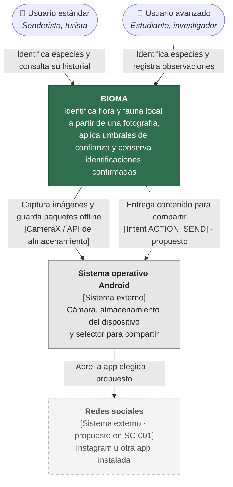
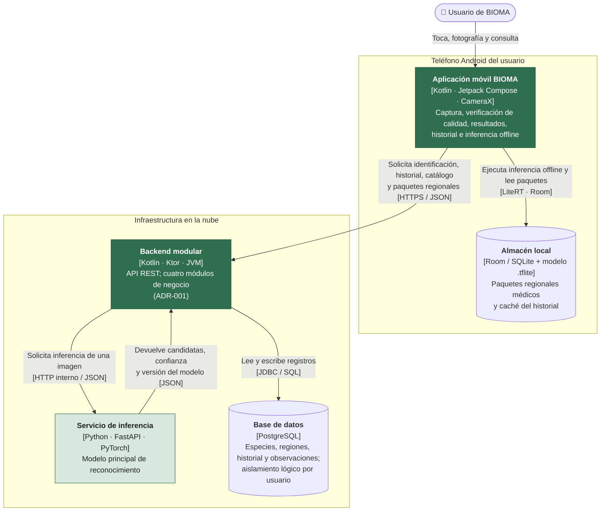
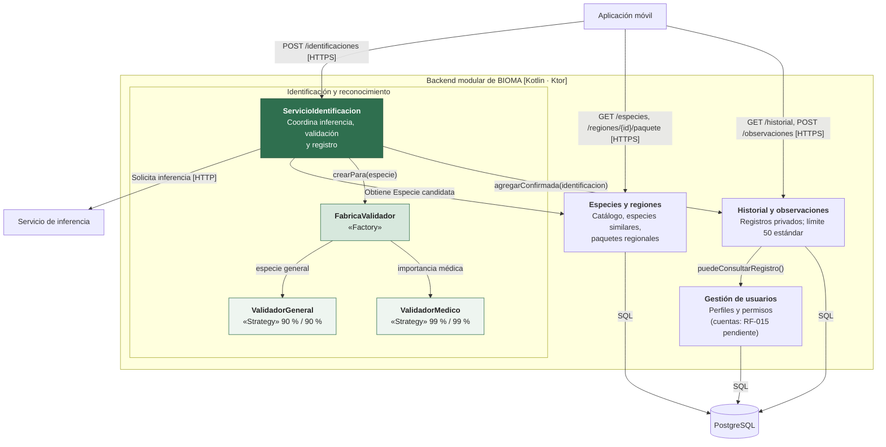

# Arquitectura de BIOMA — Modelo C4

**Sistema:** BIOMA — Sistema de detección de flora y fauna local para senderistas  
**Autor:** Santiago Pacheco Carrillo  
**Asignatura:** Ingeniería de Software I · SIS3407  
**Versión:** 2.0 · 17/11/2026  
**Decisiones relacionadas:** [ADR-001](adr-001-monolito-modular.md) · [ADR-002](adr-002-tecnologias.md) · [ADR-003 (propuesto)](adr-003-compartir-nativo.md)  
**Especificación de referencia:** [`especificacion-requisitos.md`](../especificacion-requisitos.md) v1.2

> **Estado:** arquitectura **diseñada**, no implementada. El repositorio no contiene código fuente; las tecnologías provienen de ADR-002 y son decisiones de diseño.

## Cambios respecto a la versión 1 (27/10/2026)

| Cambio | Motivo |
|---|---|
| El contexto (nivel 1) muestra sistemas externos: Android y redes sociales. | La versión 1 no mostraba con qué sistemas externos interactúa BIOMA. El análisis de sustantivos (`DOO_S12S13.md` §4) ya clasificaba la cámara y el dispositivo como sistemas externos. |
| Cada contenedor indica su tecnología y cada flecha su protocolo. | Antes solo dos flechas indicaban HTTPS. Las tecnologías se registran en ADR-002. |
| El almacén local y el modelo offline aparecen como contenedor del dispositivo. | Antes la identificación offline era una flecha de la aplicación hacia sí misma, sin indicar dónde residen los paquetes regionales. |
| Los componentes `FabricaValidador`, `ValidadorGeneral` y `ValidadorMedico` corresponden a clases del modelo UML. | Antes el patrón Factory/Strategy aparecía solo en C4 y no en el diagrama de clases ni en el de secuencia. |
| `Gestión de usuarios` se limita a perfiles y permisos. | La autenticación con cuentas (RF-015) sigue pendiente de aprobación; la arquitectura no la da por hecha. |

---

## 1. Contexto — C4 Nivel 1

**Lectura:** BIOMA no depende de servicios de terceros para identificar especies, porque el servicio de inferencia es parte del sistema (ADR-002). Sus fronteras externas son el sistema operativo del teléfono y, si se aprueba SC-001, las aplicaciones de redes sociales a través del selector nativo. Las líneas punteadas son **propuestas** y no forman parte de la línea base.

---

## 2. Contenedores — C4 Nivel 2

| Contenedor | Tecnología | Requisitos que atiende |
|---|---|---|
| Aplicación móvil | Kotlin, Jetpack Compose, CameraX, LiteRT (TensorFlow Lite) | RF-013, RF-012, RF-003, RF-008, RF-010, RF-011 |
| Almacén local | Room/SQLite y archivo de modelo `.tflite` del paquete regional | RF-008, RF-009 |
| Backend modular | Kotlin, Ktor (JVM), REST/JSON | RF-001, RF-002, RF-004, RF-006, RF-007, RF-014 |
| Servicio de inferencia | Python, FastAPI, PyTorch | RF-001, RNF-CON-002, RNF-CON-003, RNF-REN-001 |
| Base de datos | PostgreSQL | RF-004, RF-014, RNF-SEG-001, RNF-ESC-001 |

---

## 3. Componentes del backend — C4 Nivel 3

### Patrones y dónde están

| Patrón | Ubicación | Por qué en BIOMA |
|---|---|---|
| **Strategy** | `ValidadorConfirmacion` con sus implementaciones `ValidadorGeneral` (precisión del modelo ≥ 90 % y confianza ≥ 90 %) y `ValidadorMedico` (≥ 99 % y ≥ 99 %). | La regla de confirmación cambia según el tipo de especie (RNF-CON-002 y RNF-CON-003). Cada umbral queda encapsulado y se puede probar por separado. |
| **Factory** | `FabricaValidador.crearPara(especie)` | La elección de la estrategia depende de `Especie.esDeImportanciaMedica()`. La fábrica concentra esa decisión en un solo lugar. |
| **Monolito modular** | Backend completo | Lo justifica ADR-001: un solo desarrollador y fronteras de módulos que todavía cambian. |

Las clases de validación viven en un módulo de dominio en Kotlin puro, compartido por el backend y la aplicación (ADR-002). Así, la inferencia offline aplica **la misma** `ValidadorMedico` que la nube, sin duplicar la regla del 99 %.

---

## 4. Correspondencia con otros artefactos

| Elemento C4 | Dónde aparece también |
|---|---|
| Aplicación móvil, Backend modular, Servicio de inferencia | Participantes del diagrama de secuencia ([`modelo-uml.md`](modelo-uml.md) §3) |
| `ServicioIdentificacion`, `FabricaValidador`, `ValidadorGeneral`, `ValidadorMedico` | Diagrama de clases (§2) y secuencia (§3) de `modelo-uml.md` |
| Almacén local con paquetes regionales | Clase `PaqueteRegional`; carril «Aplicación móvil» del diagrama de actividad (§5) |
| Cuatro módulos de negocio | ADR-001; paquetes del modelo de clases (§2, tabla de paquetes) |
