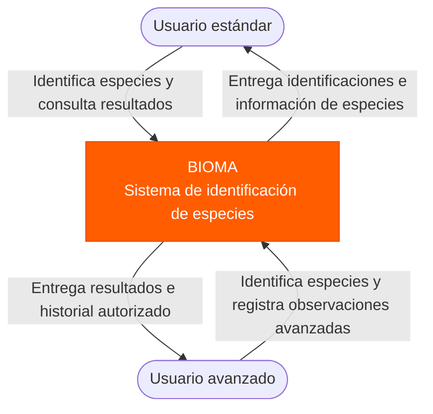
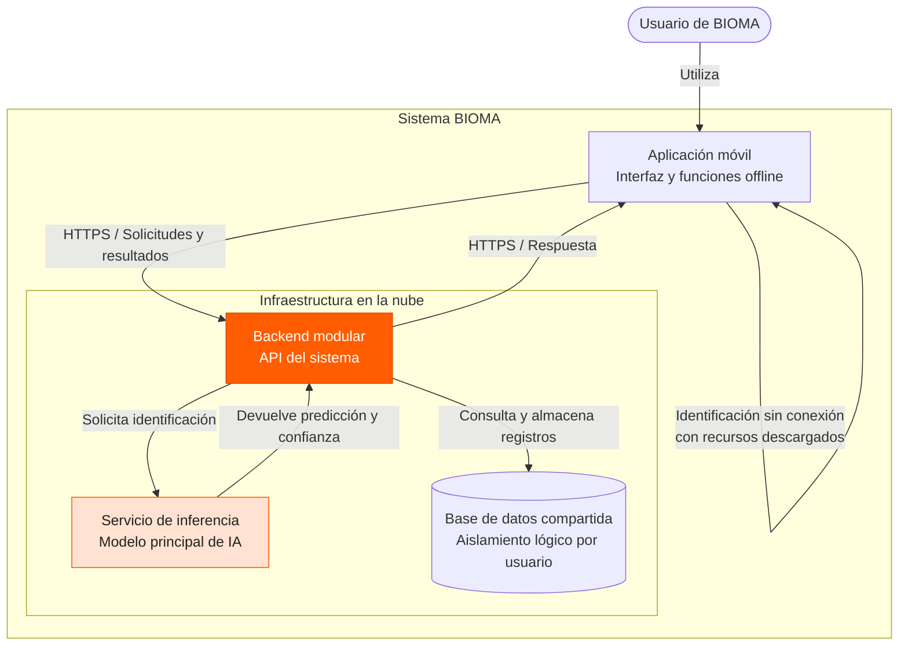
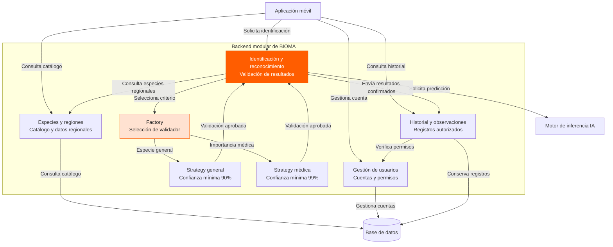
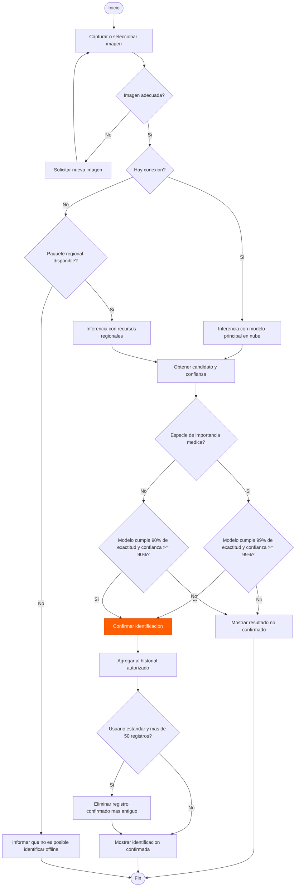
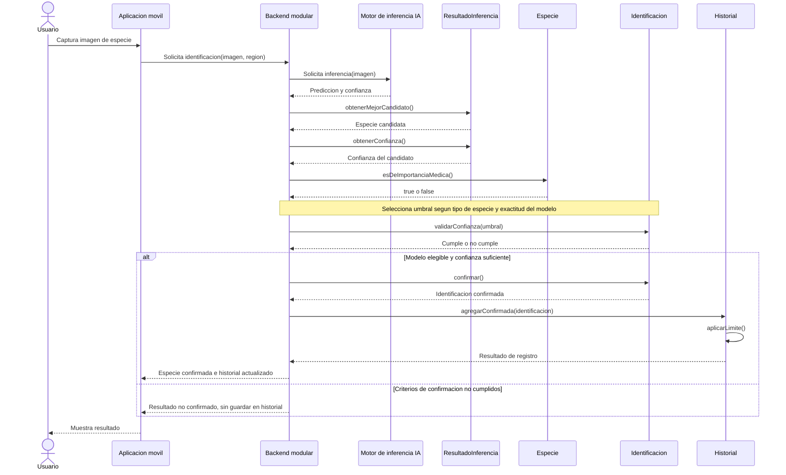
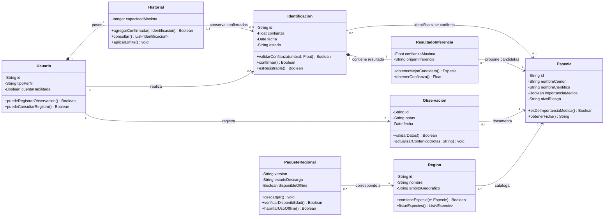
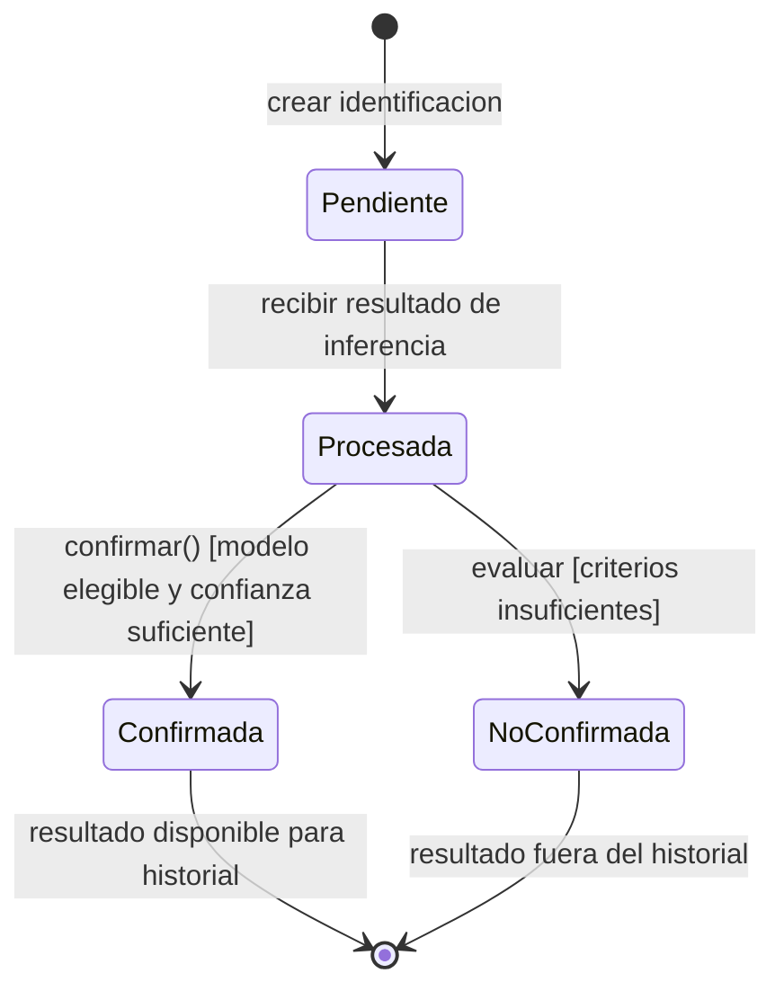
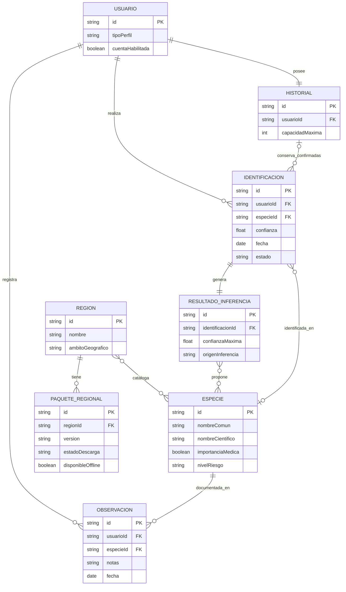
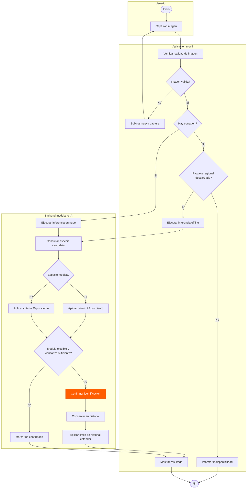

# Diagramas ADR - Ingeniería de Software

Este documento reúne los diagramas de arquitectura y modelado de BIOMA. Los diagramas 1–3 se conservan de la versión original; los restantes se adaptan al dominio de identificación de especies. Son modelos de diseño, no evidencia de implementación ejecutada.

---

# Registros de decisión y taller de diagramas

## 1. Diagrama de contexto — C4 Nivel 1

## 2. Diagrama de contenedores — C4 Nivel 2

## 3. Diagrama de componentes — C4 Nivel 3

---

# Diagramas de diseño y comportamiento de BIOMA

> **Alcance:** Los diagramas 4–9 representan el flujo de identificación de especies y sus datos. Los porcentajes del modelo son 90 % para especies generales y 99 % para especies de importancia médica. La confianza por sí sola no garantiza que el modelo cumpla su requisito de exactitud; ambos criterios deben verificarse.

## 4. Diagrama de flujo con decisiones — Identificación de especies

## 5. Diagrama de secuencia — CU-01 Identificar especie

> Los participantes `Aplicación móvil`, `Backend modular` y `Motor IA` son componentes de arquitectura. Los mensajes dirigidos a objetos de dominio usan operaciones declaradas en el diagrama de clases. Las llamadas a componentes representan intercambios entre subsistemas, no métodos añadidos a clases.

**Consistencia:** `validarConfianza()` valida el umbral de confianza; la elegibilidad por exactitud del modelo se comprueba en el componente de identificación del backend. En una implementación real deben definirse las operaciones del servicio que realiza esta segunda verificación.

## 6. Diagrama de clases — Modelo de dominio BIOMA

> **Nota de alcance:** La multiplicidad `0..50` representa el historial del usuario estándar (RNF-ESC-001). Si el perfil avanzado tiene otra capacidad, el modelo de clases deberá distinguir esa variante. Se conserva la multiplicidad original para no modificar silenciosamente el diseño previamente entregado.

## 7. Diagrama de estados — Ciclo de vida de Identificacion

> Máquina de estados de **una instancia de `Identificacion`**. Los nombres corresponden a valores propuestos para el atributo `estado` de esa clase; conviene formalizarlos como enumeración en la especificación.

`Confirmada` y `NoConfirmada` son estados terminales del proceso de identificación, no una indicación de que la instancia deba borrarse inmediatamente. El diagrama no introduce un estado de "Compartida": compartir en redes es una acción externa sobre un resultado y no modifica su confirmación.

## 8. Diagrama entidad-relación — Modelo lógico conceptual de BIOMA

> Propuesta conceptual de persistencia derivada del dominio, **no esquema SQL verificado**. `ResultadoInferencia` puede ser transitorio y no requiere necesariamente una tabla persistente. Las identificaciones no confirmadas no se vinculan al historial.

**Restricciones de negocio no expresadas por el ER:** para usuarios estándar el historial conserva como máximo 50 identificaciones confirmadas; el ingreso 51 elimina la más antigua. Las relaciones muchos-a-muchos de región/especie y resultado/especie requerirían tablas puente si se implementan en una base relacional.

## 9. Diagrama de actividad — Identificación y registro

> Mermaid aproxima la notación UML de actividad mediante `flowchart`, decisiones y subgrafos por responsable.

## 10. Taller de consistencia entre diagramas

| Verificación | Resultado |
|---|---|
| Clases ↔ Secuencia | `ResultadoInferencia.obtenerMejorCandidato()`, `obtenerConfianza()`, `Especie.esDeImportanciaMedica()`, `Identificacion.validarConfianza()`, `confirmar()` y `Historial.agregarConfirmada()` / `aplicarLimite()` aparecen en ambos. |
| Clases ↔ Estados | `Identificacion.estado` existe. Sus valores se proponen como `Pendiente`, `Procesada`, `Confirmada` y `NoConfirmada`; falta tiparlos formalmente en la clase. |
| Arquitectura ↔ Secuencia | La aplicación móvil, el backend y el motor IA corresponden a los contenedores C4. |
| Requisitos ↔ Diagramas | CU-01 identificación; CU-02 historial; CU-04 identificación offline; CU-05 paquetes regionales; RNF-ESC-001 límite de historial. Confirmar los identificadores contra la versión final de la especificación. |
| Impacto de SC-001 | **No incorporado a la línea base**: compartir escaneos es una solicitud propuesta y debe reflejarse en estos diagramas solo si se acepta y se actualiza la especificación. |

### Puntos que conviene resolver antes de cerrar el diseño

1. **Exactitud del modelo:** `validarConfianza(umbral)` solo recibe el umbral de confianza; la verificación de exactitud del modelo (90 % o 99 %) necesita una responsabilidad explícita en el backend o un ajuste de operaciones del dominio.
2. **Identificación offline:** la secuencia 5 describe la ruta en nube; la ruta offline aparece en los diagramas de flujo y actividad. Si se requiere una secuencia para CU-04, debe elaborarse por separado.
3. **Historial avanzado:** `0..50` es correcto para el perfil estándar, pero no describe necesariamente el avanzado.
4. **Persistencia:** el diagrama ER es conceptual. Antes de convertirlo en SQL hay que resolver tablas puente, claves externas y si se persisten resultados no confirmados.
