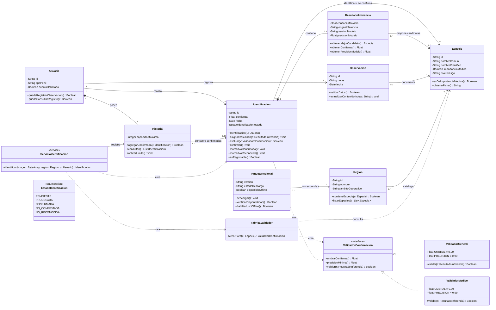
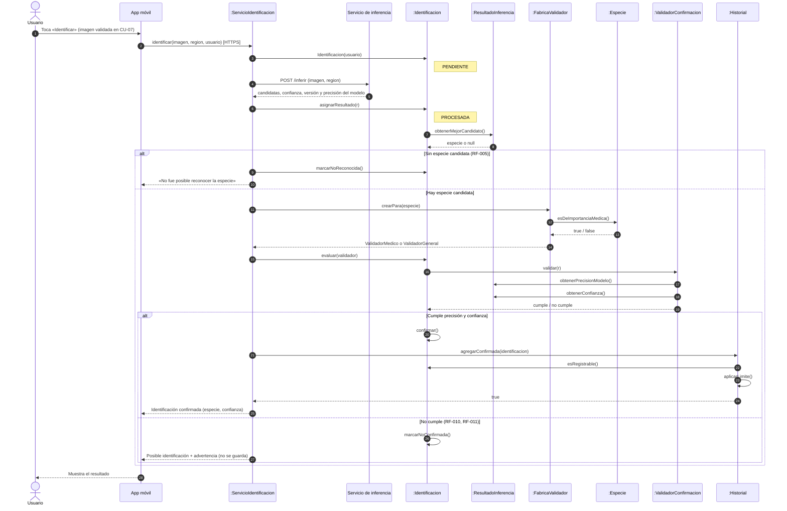
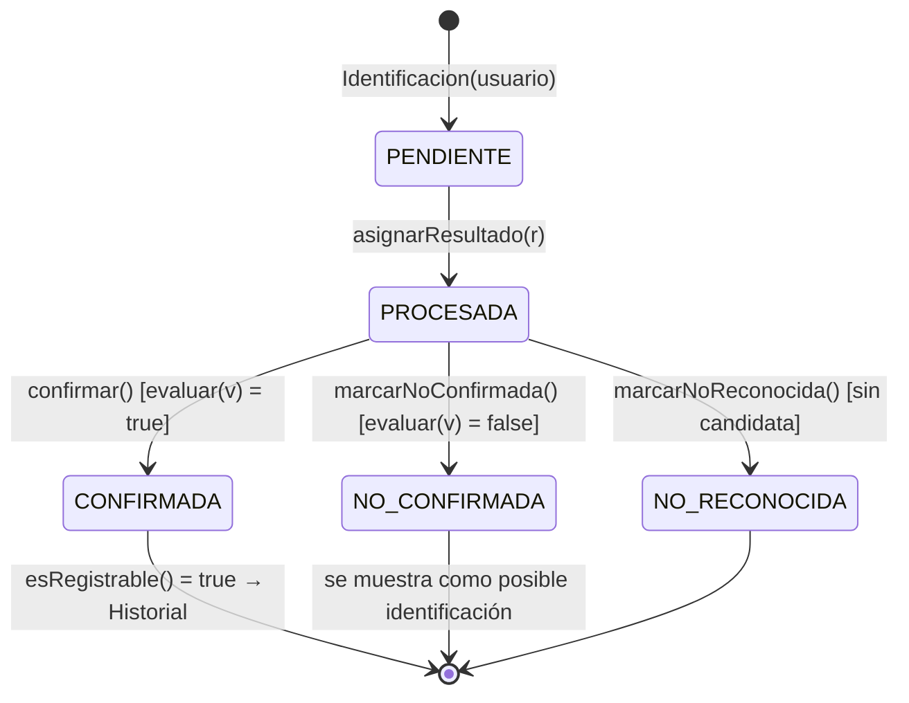
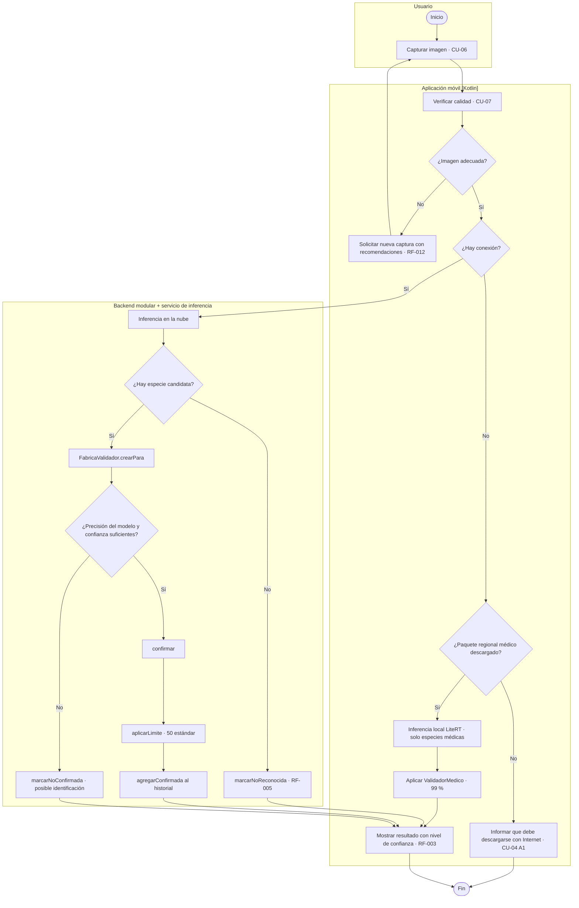
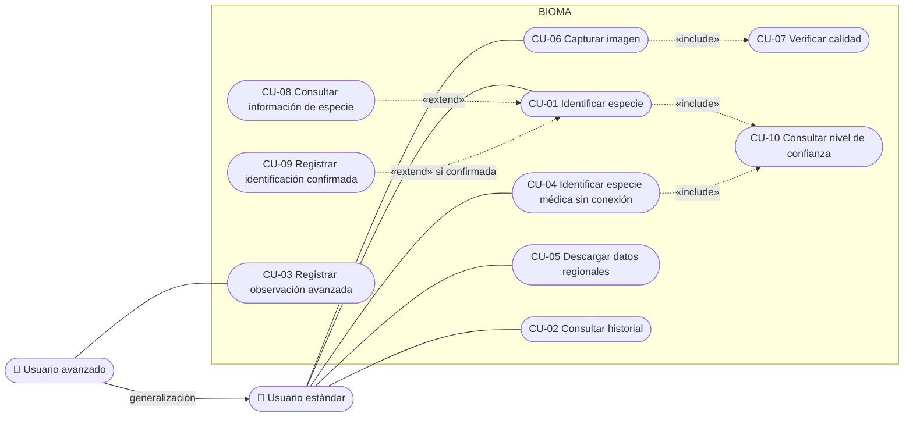
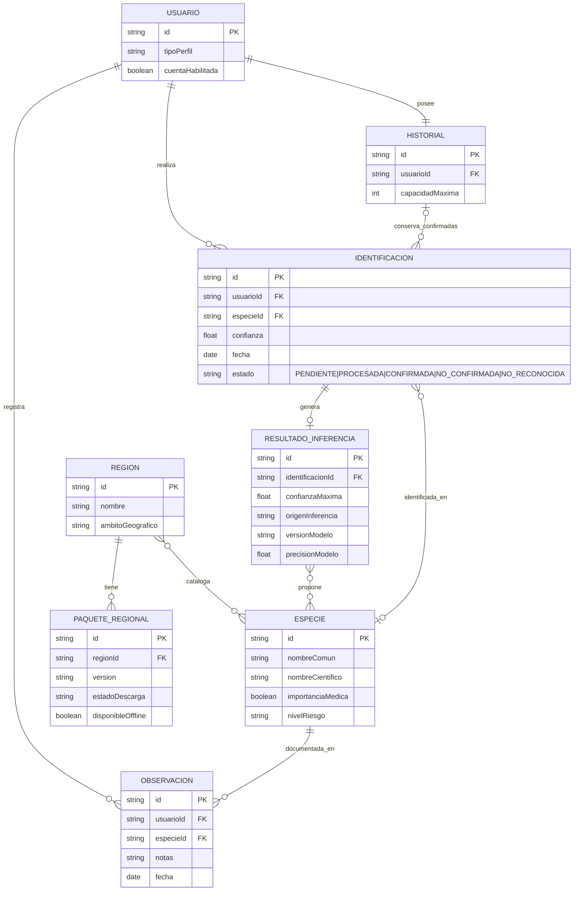

# Modelo UML de BIOMA — estructura y comportamiento

**Sistema:** BIOMA — Sistema de detección de flora y fauna local para senderistas  
**Autor:** Santiago Pacheco Carrillo  
**Asignatura:** Ingeniería de Software I · SIS3407  
**Versión:** 2.0 · 17/11/2026  
**Arquitectura relacionada:** [`arquitectura-c4.md`](arquitectura-c4.md)  
**Versión anterior del modelo de clases:** [`DOO_S12S13.md`](DOO_S12S13.md) §5 (04/11/2026)

> Son modelos de **diseño**, no evidencia de implementación ejecutada. El repositorio no contiene código fuente.

---

## 1. Qué cambió al modelar la secuencia (v1 → v2)

Al dibujar la secuencia de CU-01 con el diagrama de clases de `DOO_S12S13.md` aparecieron tres huecos:

| # | Hueco detectado | Cómo apareció | Corrección en v2 |
|---|---|---|---|
| 1 | **Nadie verificaba la precisión del modelo.** `validarConfianza(umbral)` solo comparaba la confianza de una inferencia, pero el alcance exige además que el modelo cumpla 90 % o 99 % de precisión (RNF-CON-002 y RNF-CON-003). | El mensaje que debía decidir «modelo elegible» no tenía una operación a la que dirigirse. Quedó como nota sobre el backend. | `ResultadoInferencia` conserva `precisionModelo` y `versionModelo`. La interfaz `ValidadorConfirmacion` evalúa ambos criterios. `validarConfianza(umbral)` se sustituye por `evaluar(v)`. |
| 2 | **El patrón Factory/Strategy existía solo en C4.** | La secuencia necesitaba elegir un umbral y no había clase que lo hiciera. | Se agregan `FabricaValidador`, `ValidadorConfirmacion`, `ValidadorGeneral` y `ValidadorMedico`. |
| 3 | **Los estados no tenían operaciones que los produjeran.** `estado` era un `String` y la transición `evaluar` no existía en la clase. | El diagrama de estados usaba transiciones sin una operación correspondiente. | Se agrega la enumeración `EstadoIdentificacion` y las operaciones `asignarResultado()`, `marcarNoConfirmada()` y `marcarNoReconocida()`. |

Otras correcciones:
- La secuencia ahora crea la `Identificacion` y usa `esRegistrable()`.
- `aplicarLimite()` se ejecuta **antes** de agregar, como indica CU-09 A1.
- El diagrama de actividad limita el modo offline a especies de importancia médica (RF-008) y lo coloca en el carril de la aplicación, no en el del backend.

---

## 2. Diagrama de clases (v2)

**Decisiones de multiplicidad que cambiaron:**

- `Identificacion "1" *-- "0..1" ResultadoInferencia`: una identificación recién creada (`PENDIENTE`) todavía no tiene resultado.
- `ResultadoInferencia "0..*" --> "0..*" Especie`: antes era `1..*`. Una especie fuera del modelo no genera candidatas (RF-005, estado `NO_RECONOCIDA`).
- `0..50` sigue siendo la capacidad del **usuario estándar** (RNF-ESC-001). La capacidad del usuario avanzado no está especificada; queda pendiente.

**Agrupación por módulo (ADR-001):**

| Módulo | Clases |
|---|---|
| Identificación y reconocimiento | `ServicioIdentificacion`, `Identificacion`, `EstadoIdentificacion`, `ResultadoInferencia`, `FabricaValidador`, `ValidadorConfirmacion`, `ValidadorGeneral`, `ValidadorMedico` |
| Especies y regiones | `Especie`, `Region`, `PaqueteRegional` |
| Gestión de usuarios | `Usuario` |
| Historial y observaciones | `Historial`, `Observacion` |

---

## 3. Diagrama de secuencia — CU-01 Identificar una especie (en línea)

> `App`, `Servicio de inferencia` y el actor son contenedores o actores de C4: sus mensajes son llamadas HTTP, no operaciones de clase. **Cada mensaje dirigido a un objeto de dominio corresponde a una operación declarada en §2.**

### Correspondencia mensaje → operación

| Mensaje | Clase | Operación declarada |
|---|---|---|
| 2 `identificar(imagen, region, usuario)` | `ServicioIdentificacion` | `+identificar(imagen, region, u) Identificacion` |
| 3 `Identificacion(usuario)` | `Identificacion` | constructor `+Identificacion(u: Usuario)` |
| 6 `asignarResultado(r)` | `Identificacion` | `+asignarResultado(r) void` |
| 7 `obtenerMejorCandidato()` | `ResultadoInferencia` | `+obtenerMejorCandidato() Especie` |
| 11 `crearPara(especie)` | `FabricaValidador` | `+crearPara(e: Especie) ValidadorConfirmacion` |
| 12 `esDeImportanciaMedica()` | `Especie` | `+esDeImportanciaMedica() Boolean` |
| 15 `evaluar(validador)` | `Identificacion` | `+evaluar(v: ValidadorConfirmacion) Boolean` |
| 16 `validar(r)` | `ValidadorConfirmacion` | `+validar(r: ResultadoInferencia) Boolean` |
| 17–18 `obtenerPrecisionModelo()`, `obtenerConfianza()` | `ResultadoInferencia` | `+obtenerPrecisionModelo() Float`, `+obtenerConfianza() Float` |
| 20, 26, 9 `confirmar()`, `marcarNoConfirmada()`, `marcarNoReconocida()` | `Identificacion` | operaciones homónimas |
| 21 `agregarConfirmada(identificacion)` | `Historial` | `+agregarConfirmada(i: Identificacion) Boolean` |
| 22 `esRegistrable()` | `Identificacion` | `+esRegistrable() Boolean` |
| 23 `aplicarLimite()` | `Historial` | `+aplicarLimite() void` |

---

## 4. Diagrama de estados — ciclo de vida de `Identificacion`

Cada estado es un valor de `EstadoIdentificacion`, y cada transición se dispara con una operación de `Identificacion`.

`CONFIRMADA`, `NO_CONFIRMADA` y `NO_RECONOCIDA` son estados finales del **proceso** de identificación; no significan que la instancia se borre de inmediato. Compartir en redes (SC-001, propuesto) no agrega ningún estado, porque es una acción externa sobre un resultado y no altera su confirmación.

---

## 5. Diagrama de actividad — identificación en línea y sin conexión

> **Pendiente de especificar:** si una identificación confirmada offline se registra en el historial cuando se recupera la conexión. CU-04 no lo define y este diagrama no lo presupone.

---

## 6. Casos de uso (catálogo v1.2)

El diagrama editable está en [`../diagramas/casos-de-uso.drawio`](../diagramas/casos-de-uso.drawio), con su exportación [`casos-de-uso.drawio.png`](../diagramas/casos-de-uso.drawio.png). Esta versión en Mermaid es una aproximación textual:

---

## 7. Diagrama entidad-relación conceptual

> Propuesta de persistencia en PostgreSQL (ADR-002), **no esquema SQL verificado**. Las identificaciones no confirmadas no se vinculan al historial.

---

## 8. Revisión de consistencia (v2)

| Verificación | Resultado |
|---|---|
| Secuencia ↔ clases | Los 16 mensajes dirigidos a objetos de dominio corresponden a operaciones declaradas (tabla §3). |
| Estados ↔ clases | Los cinco estados son valores de `EstadoIdentificacion` y cada transición es una operación de `Identificacion`. |
| C4 ↔ clases | `ServicioIdentificacion`, `FabricaValidador`, `ValidadorGeneral` y `ValidadorMedico` aparecen en el nivel 3 de C4, en las clases y en la secuencia. |
| C4 ↔ secuencia | La app móvil, el backend y el servicio de inferencia corresponden a contenedores del nivel 2. |
| Actividad ↔ requisitos | La ruta offline aplica solo a especies médicas (RF-008) y siempre usa el umbral del 99 %. |
| Casos de uso ↔ especificación | Los 10 CU del catálogo v1.2 están en el `.drawio`, en el PNG y en §6. |
| SC-001 | **No incorporado a la línea base.** RF-016, CU-11 y ADR-003 son propuestas. |

### Pendientes declarados

1. Capacidad del historial del usuario avanzado.
2. Registro en el historial de identificaciones confirmadas offline.
3. RF-015 (cuentas): `Usuario.cuentaHabilitada` se conserva, pero el mecanismo de autenticación no está decidido.
4. Persistencia: el ER es conceptual; faltan tablas puente y la política para resultados no confirmados.
